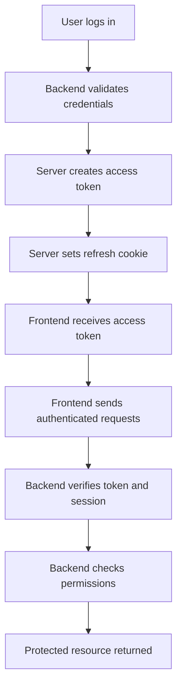

# DocHub

An internal knowledge base and technical documentation platform for teams. Create, organize, manage, and share technical articles with role-based access control, group permissions, and secure authentication. Built with FastAPI and React, backed by Supabase PostgreSQL.

## Status

Core application features include user authentication, article management, role-based authorization, group permissions, administrative tools, session management, and security monitoring.

## Features

### Core Features

- **Article Management:** Create, view, update, and manage technical documentation.
- **Markdown Editor:** Write and preview structured documentation using Markdown.
- **Categories and Tags:** Organize articles by category and tags.
- **Article Ownership:** Restrict article modifications according to ownership and permissions.
- **REST API:** Backend endpoints built with FastAPI.
- **Interactive API Documentation:** Explore API endpoints through Swagger UI.

### Authentication and Security

- **Registration and Login:** Authenticate users through the backend.
- **JWT Authentication:** HS256-signed access tokens with expiration.
- **Refresh Sessions:** HttpOnly refresh-token cookies and server-side session management.
- **Logout:** Revoke authentication sessions.
- **Account Security:** Validate account status and restrict banned users.
- **Password Security:** Secure password handling and password-related operations.
- **Security Validation:** Verify token signatures, expiration, and session status.

### Authorization and Groups

- **Roles:** User and Admin.
- **Role-Based Access Control:** Protect API endpoints using role and permission checks.
- **Article Ownership:** Prevent users from modifying articles they do not own.
- **Group Permissions:** Apply access restrictions based on group membership and assigned permissions.

### Administration

- User management and role changes.
- Ban user accounts.
- Revoke user sessions.
- Export user information as CSV.
- Administrative activity and security monitoring.

## Tech Stack

| Part | Choice |
|---|---|
| Backend | Python, FastAPI |
| Database | Supabase PostgreSQL |
| Frontend | React, TypeScript, Vite |
| Styling | Tailwind CSS |
| Authentication | JWT (HS256) |
| Authorization | RBAC and permission checks |
| API Communication | Axios |
| Hosting | Vercel (frontend; backend deployment should be verified) |

## Project Structure

```text
DocHub/
├── backend/
│   ├── app/
│   │   ├── routes/          # API endpoints
│   │   ├── repositories/    # Database operations
│   │   ├── schemas/         # Request and response schemas
│   │   ├── main.py          # FastAPI application
│   │   └── ...
│   ├── tests/               # Backend tests
│   └── requirements.txt
├── frontend/
│   ├── src/
│   │   ├── components/      # Reusable UI components
│   │   ├── pages/           # Application pages
│   │   ├── services/        # API communication
│   │   └── ...
│   └── package.json
├── docs/                    # Project documentation
└── vercel.json              # Deployment configuration
```

## How It Works

### Frontend

React renders the application interface. Components provide reusable UI elements, pages organize application screens, and frontend services communicate with the FastAPI backend.

### Backend

FastAPI handles HTTP requests through route handlers. Repository functions manage database operations through Supabase, while schemas validate incoming data and structure API responses.

### Database

Supabase PostgreSQL stores application data, including user profiles, articles, categories, groups, memberships, and authentication sessions.

## Authentication Flow



The access token is signed using HS256 and includes an expiration time. The refresh token is handled through an HttpOnly cookie, while the backend validates the associated session and account status.

## Requirements

- [Python](https://www.python.org/downloads/) 3.11+
- [Node.js](https://nodejs.org/) 22+
- [Supabase](https://supabase.com/) project credentials

> On macOS/Linux, use `python3` instead of `python` if required.

## Run Locally

You need two terminals: one for the backend and one for the frontend.

### First Time (Initial Setup)

**Backend (terminal 1):**

```bash
cd backend
python -m venv .venv

# Windows PowerShell
.venv\Scripts\Activate.ps1

# macOS/Linux
source .venv/bin/activate

pip install -r requirements.txt
```

Configure the required backend environment variables using the names defined in the backend configuration. Add your Supabase credentials and authentication secrets.

Start the backend:

```bash
uvicorn app.main:app --reload
```

**Frontend (terminal 2):**

```bash
cd frontend
npm install
```

Configure the frontend API base URL using the environment variable expected by the frontend configuration.

For example:

```env
VITE_API_URL=http://127.0.0.1:8000
```

Start the frontend:

```bash
npm run dev
```

### Running Again

**Backend (terminal 1):**

```bash
cd backend
source .venv/bin/activate
uvicorn app.main:app --reload
```

**Frontend (terminal 2):**

```bash
cd frontend
npm run dev
```

Run `pip install -r requirements.txt` or `npm install` again only when dependencies change.

Open [http://localhost:5173](http://localhost:5173).

API documentation: [http://localhost:8000/docs](http://localhost:8000/docs).

## Deployment

The frontend is deployed through Vercel. Supabase PostgreSQL provides the production database.

Production deployment requires the appropriate backend and frontend environment variables. Never commit secrets, API keys, or `.env` files to GitHub.

## Contributing

The project source code and development history are maintained in GitHub.

Repository: https://github.com/sadmansakibornob/DocHub

## Troubleshooting

- **Backend fails to start:** Activate the virtual environment and install dependencies.
- **ModuleNotFoundError:** Run `pip install -r requirements.txt`.
- **Frontend dependencies missing:** Run `npm install` inside `frontend/`.
- **API connection error:** Ensure the backend is running and the frontend API URL is correct.
- **Database connection error:** Verify the Supabase URL and credentials.
- **Authentication errors:** Check the JWT and session configuration.
- **CORS errors:** Verify the backend's allowed frontend origins.
- **Frontend build errors:** Check the Vite build output and installed dependencies.
