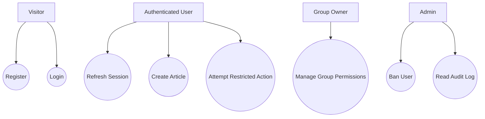
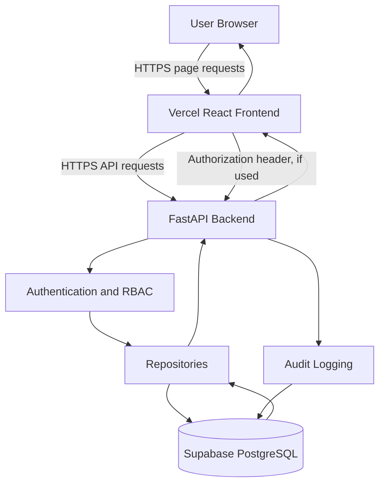
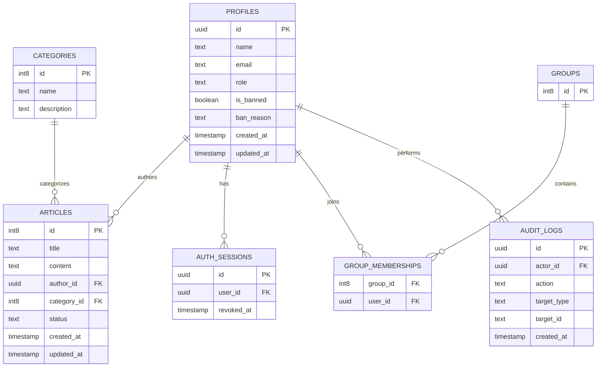
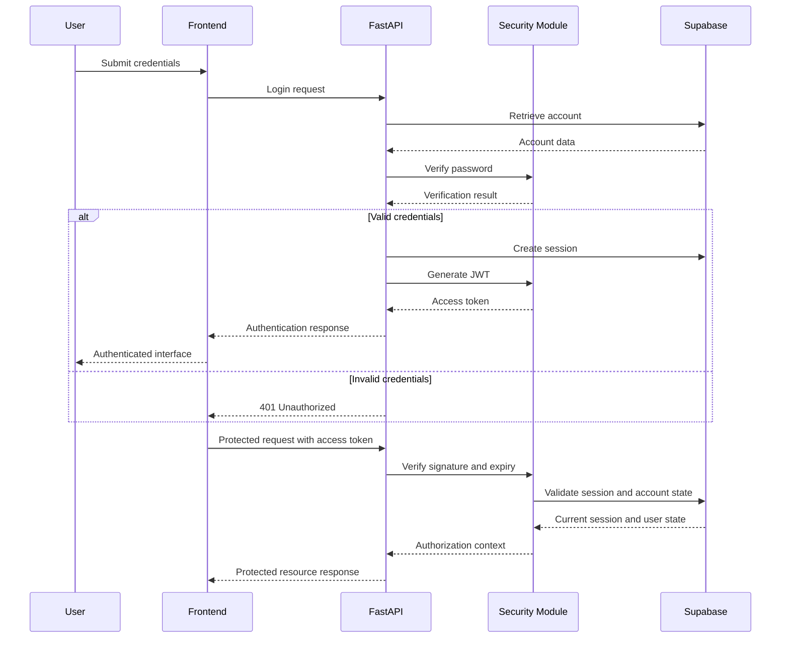
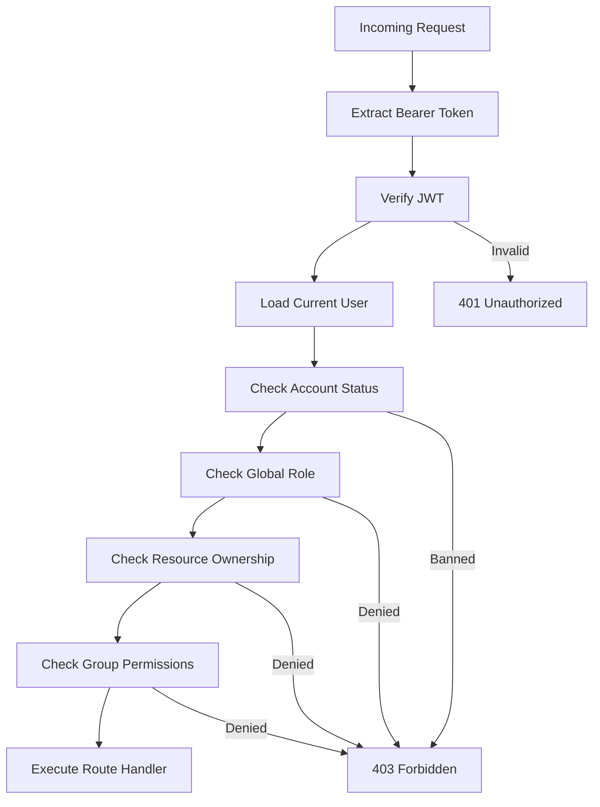
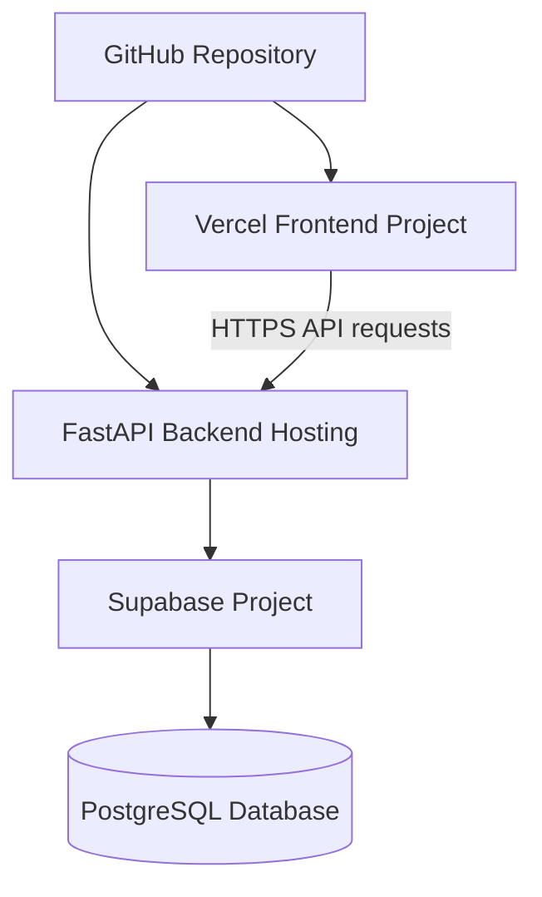

# Independent University, Bangladesh

## CSE309 — Web Application & Internet

# Final Project Submission Report

**Submitted by:**

- Name: `Sadman Sakib Ornob`
- Student ID: `2330305`
- Section: `06`
- Serial Number: `30`

**Project Title:** DocHub — Internal Knowledge-Sharing Platform

**Vercel URL:** https://dochub-mauve.vercel.app/

**GitHub Repository:** https://github.com/sadmansakibornob/DocHub

**Submitted To:**

Sayef Reyadh  
Adjunct Lecturer  
Department of Computer Science & Engineering  
Independent University, Bangladesh

**Semester:** Autumn 2026  
**Date of Submission:** `28 November 2026`

---

# Table of Contents

1. Executive Summary
2. Part A — Product Requirements (PRD)
3. Part B — Software Requirements (SRS)
4. Part C — Technical Design (TDD)
5. Part D— Project Management and Conclusion

# 1. Executive Summary

## 1.1 Project Overview

DocHub is an internal knowledge-sharing platform designed to help users create, organize, manage, and access documentation in a centralized environment. The platform provides article management, categories, group collaboration, user authentication, and administrative controls. It aims to make documentation easier to maintain and share while ensuring that users can only access resources they are authorized to use.

The system uses a web-based architecture. The frontend provides the user interface, while the backend handles business logic, authentication, authorization, and database operations. Supabase PostgreSQL stores application data.

**Technology stack:** React, TypeScript, Vite, Tailwind CSS, Axios, Python FastAPI, Pydantic, Supabase PostgreSQL, JWT, and Vercel.

## 1.2 What Was Built Since the Mid Assessment

The project was extended beyond its initial CRUD functionality with additional authentication, authorization, collaboration, and administration features.

- **JWT Authentication:** Added token-based authentication, access-token verification, refresh-session handling, and logout functionality. The exact token transport and rotation behavior are described in the authentication design section.
- **Role-Based Access Control:** Implemented two global account roles, `user` and `admin`, with backend permission checks. Resource ownership and group-level permissions provide additional access restrictions.
- **Admin Dashboard:** Added administrative views for dashboard statistics, user management, content moderation, group moderation, audit information, and security-related information.
- **Audit Logging:** Added an audit module to record important administrative and security-related actions.
- **Session Management:** Added session validation and revocation capabilities.
- **Account Security:** Added account banning and unbanning functionality, including session revocation for banned accounts.
- **Deployment:** Deployed the frontend to Vercel and connected it to the backend API and Supabase database.

## 1.3 Live Links

**Table 1: Project links**

| Resource            | Link                                         |
| ------------------- | -------------------------------------------- |
| GitHub Repository   | `https://github.com/sadmansakibornob/DocHub` |
| Vercel Frontend     | `https://dochub-mauve.vercel.app `           |
| Backend API         | `https://dochub-mauve.vercel.app/api`        |
| API Documentation   | `https://dochub-mauve.vercel.app/api/docs`   |
| Video Demonstration | `https://youtu.be/tIeMKEugI-o`               |

Test account credentials are intentionally excluded from this Markdown file. They are provided separately in the PDF appendix.

---

# Part A. Product Requirements (PRD)

## A1. Problem Statement

Documentation is an important part of software development, academic projects, and team collaboration. However, information is often distributed across different files, messages, cloud storage services, and personal notes. This makes it difficult for users to find the correct information, maintain updated documentation, and share knowledge with other team members.

When documentation is managed without a centralized platform, several problems can occur. Users may work with outdated information, duplicate existing documents, or lose track of who created and modified particular content. Managing access to shared documents can also become difficult, especially when different users require different levels of access.

A centralized documentation platform is therefore useful for organizing information, managing collaboration, and maintaining accountability. A system should also provide administrative controls so that inappropriate content and unauthorized account activity can be managed effectively.

## A2. Users and Roles

DocHub uses two global account roles: `user` and `admin`. Visitors are unauthenticated users. Group membership and group permissions are separate from global account roles.

**Table 2: Users and roles**

| Role         | Who they are                       | Main tasks                                                                                   | What they must never be able to do                                                                                                                           |
| ------------ | ---------------------------------- | -------------------------------------------------------------------------------------------- | ------------------------------------------------------------------------------------------------------------------------------------------------------------ |
| Visitor      | A person who has not authenticated | Visit public pages and access permitted public information                                   | Access protected user data or administrative features                                                                                                        |
| User         | An authenticated standard account  | Manage permitted articles, categories and account information                                | Access another user's restricted resources or administrative operations                                                                                      |
| Group member | A user associated with a group     | Access group resources according to membership permissions                                   | Perform group actions without the required permission                                                                                                        |
| Group owner  | A user with ownership of a group   | Manage group-level operations permitted to the owner                                         | Bypass platform-wide security restrictions                                                                                                                   |
| Admin        | An administrative account          | Manage users, moderate content, inspect audit information and access administrative features | Perform prohibited self-protection-sensitive operations, such as banning another admin or changing their own role, if enforced by the current implementation |

Group member and group owner describe group-level relationships, not additional global account roles.

## A3. Goals and Success Measures

**Table 3: Goals and success measures**

| ID   | Goal                                         | Success measure                                                              |
| ---- | -------------------------------------------- | ---------------------------------------------------------------------------- |
| G-01 | Provide centralized documentation management | An authenticated user can create, view, update and delete permitted articles |
| G-02 | Provide secure authentication                | Invalid credentials and invalid or expired access tokens are rejected        |
| G-03 | Enforce role-based access control            | A normal user cannot access an admin-only endpoint                           |
| G-04 | Protect private resources                    | A user cannot modify another user's restricted article                       |
| G-05 | Support group collaboration                  | Group access is checked against membership and applicable permissions        |
| G-06 | Provide administrative accountability        | Important administrative operations create audit records                     |

## A4. Scope and Non-Goals

### In Scope

- User registration and login.
- JWT-based authentication.
- Access-token verification and session management.
- Global roles: `user` and `admin`.
- Backend authorization and ownership checks.
- Group creation and group-related collaboration.
- Group membership and permissions.
- Article creation, retrieval, updating and deletion.
- Article categories.
- Article publication statuses: `draft`, `review`, and `published`.
- Administrative dashboard.
- User management and account banning.
- Content and group moderation.
- Audit logging.
- Security-related administrative information.
- CSV export functionality.
- Frontend deployment and backend API integration.

### Out of Scope

- Native Android and iOS applications.
- Offline-first documentation editing.
- Real-time collaborative editing unless explicitly implemented.
- Enterprise single sign-on integration.
- Paid subscriptions and billing.
- AI-generated documentation as a core requirement.
- Large-scale enterprise infrastructure.

### Assumptions and Constraints

- Users access the platform through a modern web browser.
- The frontend is hosted on Vercel.
- The backend requires a separately configured API hosting environment.
- Supabase provides the PostgreSQL database.
- The project is developed within the academic semester.
- Hosting and database usage are subject to free-tier or configured service limits.
- Security-sensitive configuration is stored in environment variables.
- The system is designed primarily for academic-project-scale usage.

## A5. User Stories

**Table 4: User stories**

| ID    | User story                                                                                                             |
| ----- | ---------------------------------------------------------------------------------------------------------------------- |
| US-01 | As a visitor, I want to register an account so that I can use the platform.                                            |
| US-02 | As a user, I want to log in securely so that I can access my account.                                                  |
| US-03 | As a user, I want to log out so that my session can be ended.                                                          |
| US-04 | As a user, I want to create an article so that I can share documentation.                                              |
| US-05 | As a user, I want to update my permitted articles so that I can maintain accurate information.                         |
| US-06 | As a user, I want to organize articles using categories so that information is easier to find.                         |
| US-07 | As a group member, I want to access group resources according to my permissions so that I can collaborate with others. |
| US-08 | As a group owner, I want to manage group membership and permissions so that I can control group access.                |
| US-09 | As an admin, I want to view dashboard statistics so that I can monitor platform activity.                              |
| US-10 | As an admin, I want to search and filter users so that I can manage accounts efficiently.                              |
| US-11 | As an admin, I want to ban or unban an account so that I can manage abusive accounts.                                  |
| US-12 | As an admin, I want to moderate articles so that inappropriate content can be managed.                                 |
| US-13 | As an admin, I want to inspect audit records so that important platform actions can be reviewed.                       |
| US-14 | As an admin, I want to revoke a user's sessions so that access can be terminated when necessary.                       |

---

# Part B. Software Requirements (SRS)

## B1. Introduction

### Purpose

This section defines the functional and non-functional requirements of DocHub. It describes the expected behavior of the application and provides testable requirements for authentication, authorization, documentation management, group collaboration, and administrative functionality.

### Intended Readers

- Course instructor and evaluators.
- Project developers.
- Testers.
- Future maintainers of the application.

### Definitions

| Term          | Definition                                                     |
| ------------- | -------------------------------------------------------------- |
| JWT           | JSON Web Token, a compact token format used to transmit claims |
| Access Token  | A token used to authenticate API requests                      |
| Refresh Token | A credential used to obtain a new access token                 |
| RBAC          | Role-Based Access Control                                      |
| Role          | A global account classification used for authorization         |
| Permission    | Authorization to perform a specific operation                  |
| Audit Log     | A record of important application or administrative actions    |
| Ownership     | The relationship between a resource and the user who owns it   |
| Session       | A server-recognized authenticated user session                 |

### References

- RFC 7519 — JSON Web Token (JWT).
- OWASP Application Security Verification Standard.
- OWASP Authentication Cheat Sheet.
- FastAPI official documentation.
- React official documentation.
- TypeScript official documentation.
- Supabase documentation.
- Vite documentation.

## B2. Functional Requirements

Requirements are grouped by application area. Each requirement has a unique identifier to support testing and traceability.

### Authentication Requirements — FR-AUTH

**Table 5: Authentication requirements**

| ID         | Requirement                                                                                                                         |
| ---------- | ----------------------------------------------------------------------------------------------------------------------------------- |
| FR-AUTH-01 | The system shall allow visitors to register an account using valid registration information.                                        |
| FR-AUTH-02 | The system shall authenticate users using their registered credentials.                                                             |
| FR-AUTH-03 | The system shall securely hash passwords before storing password information.                                                       |
| FR-AUTH-04 | The system shall use a server-side pepper where configured by the password-security implementation.                                 |
| FR-AUTH-05 | The system shall issue a signed JWT access token after successful authentication.                                                   |
| FR-AUTH-06 | The system shall include the required identity and time-related claims in the access token.                                         |
| FR-AUTH-07 | The system shall reject invalid, tampered, or expired access tokens.                                                                |
| FR-AUTH-08 | The system shall provide a refresh operation for eligible authenticated sessions.                                                   |
| FR-AUTH-09 | The system shall invalidate the relevant authentication session during logout.                                                      |
| FR-AUTH-10 | The system shall reject revoked authentication sessions.                                                                            |
| FR-AUTH-11 | The system shall prevent banned users from accessing protected endpoints.                                                           |
| FR-AUTH-12 | The system shall allow authenticated users to retrieve their own profile information.                                               |
| FR-AUTH-13 | The system shall allow permitted users to update their profile information.                                                         |
| FR-AUTH-14 | The system shall not expose passwords, password hashes, signing secrets, or complete authentication tokens in normal API responses. |
| FR-AUTH-15 | The system shall record relevant authentication and security events where audit or security logging is enabled.                     |

A separate session-list endpoint, password-change workflow, configurable lockout policy, and refresh-token rotation must be listed as completed requirements only if they are present in the final implementation.

### RBAC Requirements — FR-RBAC

**Table 6: Authorization requirements**

| ID         | Requirement                                                                            |
| ---------- | -------------------------------------------------------------------------------------- |
| FR-RBAC-01 | The system shall support exactly two global account roles: `user` and `admin`.         |
| FR-RBAC-02 | The system shall enforce authorization checks on the backend.                          |
| FR-RBAC-03 | The system shall restrict administrative endpoints to authorized administrators.       |
| FR-RBAC-04 | The system shall enforce resource ownership restrictions where applicable.             |
| FR-RBAC-05 | The system shall validate group membership before allowing protected group operations. |
| FR-RBAC-06 | The system shall enforce group-level permissions for operations requiring them.        |
| FR-RBAC-07 | The system shall prevent unauthorized users from modifying restricted resources.       |
| FR-RBAC-08 | The system shall use the current account state when evaluating access permissions.     |
| FR-RBAC-09 | The system shall reject protected requests from banned accounts.                       |
| FR-RBAC-10 | The system shall prevent unauthorized role changes.                                    |

### Administrative Requirements — FR-ADM

**Table 7: Administrative requirements**

| ID        | Requirement                                                                                |
| --------- | ------------------------------------------------------------------------------------------ |
| FR-ADM-01 | The system shall provide an administrative dashboard with platform statistics.             |
| FR-ADM-02 | The system shall allow administrators to retrieve and filter user records.                 |
| FR-ADM-03 | The system shall support pagination for administrative user listings.                      |
| FR-ADM-04 | The system shall allow administrators to view user details.                                |
| FR-ADM-05 | The system shall allow authorized administrators to change a user's global role.           |
| FR-ADM-06 | The system shall allow authorized administrators to ban a user.                            |
| FR-ADM-07 | The system shall allow authorized administrators to unban a user.                          |
| FR-ADM-08 | The system shall allow administrators to revoke a user's authentication sessions.          |
| FR-ADM-09 | The system shall provide article moderation functionality.                                 |
| FR-ADM-10 | The system shall allow authorized administrators to update an article's moderation status. |
| FR-ADM-11 | The system shall allow authorized administrators to delete moderated articles.             |
| FR-ADM-12 | The system shall provide group moderation functionality.                                   |
| FR-ADM-13 | The system shall provide access to audit records.                                          |
| FR-ADM-14 | The system shall provide access to available failed-login security information.            |
| FR-ADM-15 | The system shall support CSV export for supported administrative data.                     |

Bulk actions, detailed IP-based security filtering, and audit-log filtering should be marked as implemented only if the deployed application supports them.

### Domain Requirements — FR-DOMAIN

**Table 8: Documentation and collaboration requirements**

| ID           | Requirement                                                                               |
| ------------ | ----------------------------------------------------------------------------------------- |
| FR-DOMAIN-01 | The system shall allow authorized users to create articles.                               |
| FR-DOMAIN-02 | The system shall allow users to retrieve articles they are permitted to access.           |
| FR-DOMAIN-03 | The system shall allow authorized users to update permitted articles.                     |
| FR-DOMAIN-04 | The system shall allow authorized users to delete permitted articles.                     |
| FR-DOMAIN-05 | The system shall associate articles with their authors.                                   |
| FR-DOMAIN-06 | The system shall support article categories.                                              |
| FR-DOMAIN-07 | The system shall support article statuses of `draft`, `review`, and `published`.          |
| FR-DOMAIN-08 | The system shall provide group-related functionality.                                     |
| FR-DOMAIN-09 | The system shall enforce group membership and permissions for protected group operations. |
| FR-DOMAIN-10 | The system shall validate article and category data before database operations.           |

## B3. Non-Functional Requirements

**Table 9: Non-functional requirements**

| ID           | Category        | Requirement                                                                                                                                             |
| ------------ | --------------- | ------------------------------------------------------------------------------------------------------------------------------------------------------- |
| NFR-SEC-01   | Security        | The system shall store signing secrets and database credentials in environment variables rather than source code.                                       |
| NFR-SEC-02   | Security        | The system shall use generic authentication error messages that do not disclose whether an account exists.                                              |
| NFR-SEC-03   | Security        | The system shall validate access tokens before protected operations.                                                                                    |
| NFR-SEC-04   | Security        | The system shall prevent unauthorized access to restricted user and group resources.                                                                    |
| NFR-PERF-01  | Performance     | Administrative listings shall support bounded pagination.                                                                                               |
| NFR-PERF-02  | Performance     | Normal API requests should complete within a target of 2 seconds under expected academic-project usage, excluding external network and database delays. |
| NFR-USE-01   | Usability       | The frontend shall provide loading and error states for asynchronous operations.                                                                        |
| NFR-USE-02   | Usability       | The interface shall support common desktop and mobile browser screen sizes.                                                                             |
| NFR-REL-01   | Reliability     | Application data shall persist in the hosted PostgreSQL database across backend restarts.                                                               |
| NFR-REL-02   | Reliability     | API failures shall return appropriate HTTP status codes rather than silently succeeding.                                                                |
| NFR-MAINT-01 | Maintainability | Authentication and authorization logic shall be centralized in reusable backend modules.                                                                |
| NFR-MAINT-02 | Maintainability | Frontend API operations shall be organized into service modules.                                                                                        |
| NFR-MAINT-03 | Maintainability | Automated tests should cover critical authentication, authorization, and data-access behavior.                                                          |

Performance targets are design objectives; measured results must be reported in the testing section.

## B4. Roles and Permission Matrix

### Endpoint groups against roles

**Table 10: Endpoint groups by roles**

Legend: Yes = allowed, No = denied, Own = restricted to the user's own resources, Group permission = requires the relevant group permission.

| Endpoint group          | Visitor               | User                  | Group member                      | Group owner                       | Admin                 |
| ----------------------- | --------------------- | --------------------- | --------------------------------- | --------------------------------- | --------------------- |
| Public pages            | Yes                   | Yes                   | Yes                               | Yes                               | Yes                   |
| Authentication          | Yes                   | Yes                   | Yes                               | Yes                               | Yes                   |
| Own account information | No                    | Own                   | Own                               | Own                               | Own                   |
| Article read            | Public/permitted only | Own/permitted         | Group permission                  | Group permission                  | Administrative policy |
| Article create          | No                    | Yes, where permitted  | Group permission where applicable | Group permission where applicable | According to policy   |
| Article update          | No                    | Own/permitted         | Group permission                  | Group permission                  | Moderation policy     |
| Article delete          | No                    | Own/permitted         | Group permission                  | Group permission                  | Moderation policy     |
| Group access            | No                    | Membership required   | Yes                               | Yes                               | Administrative policy |
| Group management        | No                    | No, unless authorized | Group permission                  | Owner authority                   | Administrative policy |
| Admin dashboard         | No                    | No                    | No                                | No                                | Yes                   |
| User administration     | No                    | No                    | No                                | No                                | Yes                   |
| Audit information       | No                    | No                    | No                                | No                                | Yes, where permitted  |
| Security information    | No                    | No                    | No                                | No                                | Yes, where permitted  |

The final matrix must be checked against the actual endpoint dependencies in `rbac.py` and the route modules.

### Group permissions

**Table 11: Group permissions**

| Permission category   | Purpose                                                             | Restriction                                             |
| --------------------- | ------------------------------------------------------------------- | ------------------------------------------------------- |
| Create                | Allows a permitted user to create a group or group resource         | Requires the applicable creation permission             |
| Update                | Allows a permitted user to update group information or resources    | Requires the applicable update permission               |
| Assign                | Allows a permitted user to assign or modify group permissions       | Requires the applicable assignment authority            |
| Owner-only operations | Allows the group owner to perform operations reserved for ownership | Cannot be granted merely by being a normal group member |

Exact permission constants and assignment rules must match the group implementation.

### Administrative rules

**Table 12: Administrative rules**

| Rule                    | Expected behavior                                                                    |
| ----------------------- | ------------------------------------------------------------------------------------ |
| Admin-only endpoints    | Accessible only to authorized administrators                                         |
| Normal user role change | Not permitted without admin authorization                                            |
| Admin self-role change  | Should be rejected to prevent accidental privilege loss or escalation                |
| Admin self-ban          | Should be rejected                                                                   |
| Ban another admin       | Should be rejected if the admin-protection rule is implemented                       |
| Ban a normal user       | Allowed for an authorized admin                                                      |
| Revoke sessions         | Allowed for an authorized admin                                                      |
| Group permissions       | Global admin status does not automatically create group-level membership permissions |
| Banned account          | Protected requests must be rejected                                                  |

Any rule not implemented must be reported as a limitation rather than presented as a completed security guarantee.

## B5. Use Cases

### Use case diagram



**Table 13: Use case descriptions**

### UC-01: Log in and refresh session

**Actor:** User

**Preconditions:**

- The user has an existing account.
- The account is not banned.
- The backend is available.

**Main flow:**

1. The user opens the login page.
2. The user submits their credentials.
3. The frontend sends the login request.
4. The backend retrieves the account.
5. The backend verifies the password.
6. The backend creates or identifies an authentication session.
7. The backend issues an access token.
8. The frontend stores authentication state according to the implemented token strategy.
9. When refresh is required, the frontend requests a new access token.

**Alternative and error flows:**

- Invalid credentials: `401 Unauthorized`.
- Banned account: access denied.
- Invalid or expired refresh credential: `401 Unauthorized`.
- Server failure: `500 Internal Server Error`.

**Postconditions:** The user is authenticated, or the request is rejected.

### UC-02: Create an article

**Actor:** User

**Preconditions:**

- The user is authenticated.
- The user has permission to create an article.

**Main flow:**

1. The user opens the article editor.
2. The user enters a title and content.
3. The user selects an applicable category.
4. The frontend sends the article creation request.
5. The backend verifies the token.
6. The backend validates the request data.
7. The backend checks permissions.
8. The repository inserts the article into Supabase.
9. The API returns the created article.

**Alternative and error flows:**

- Missing or invalid fields: `422 Unprocessable Entity`.
- Missing authentication: `401 Unauthorized`.
- Insufficient permission: `403 Forbidden`.
- Database failure: appropriate server error.

**Postconditions:** A new article exists and is associated with its author.

### UC-03: Change a group member's permissions

**Actor:** Group owner or authorized group administrator

**Preconditions:**

- The actor is authenticated.
- The group exists.
- The actor has permission to assign group permissions.

**Main flow:**

1. The actor opens the group page.
2. The actor selects a member.
3. The actor selects the permitted permission change.
4. The frontend sends the request.
5. The backend validates the actor's group authority.
6. The backend validates the requested permission.
7. The backend updates the group membership or permission record.
8. The API returns the result.

**Alternative and error flows:**

- Invalid group: `404 Not Found`.
- Insufficient permission: `403 Forbidden`.
- Invalid permission value: `422 Unprocessable Entity`.

**Postconditions:** The member's group-level permissions are updated.

### UC-04: Attempt a denied action

**Actor:** Authenticated user

**Preconditions:**

- The user is authenticated.
- The user attempts an operation for which they do not have permission.

**Main flow:**

1. The user initiates the operation.
2. The frontend sends the API request.
3. The backend verifies authentication.
4. The backend checks role, ownership, or group permissions.
5. The backend denies the operation.
6. The frontend displays an error message.

**Alternative and error flows:**

- Missing or invalid token: `401 Unauthorized`.
- Authenticated but unauthorized: `403 Forbidden`.
- Resource not found or inaccessible: `404 Not Found`, according to the endpoint policy.

**Postconditions:** No unauthorized modification occurs.

### UC-05: Ban a user

**Actor:** Admin

**Preconditions:**

- The administrator is authenticated.
- The administrator has permission to manage users.
- The target account is eligible for banning.

**Main flow:**

1. The admin opens the user management page.
2. The admin selects a user.
3. The admin provides a ban reason where supported.
4. The frontend sends the ban request.
5. The backend verifies admin authorization.
6. The backend checks target-account restrictions.
7. The backend updates the banned state.
8. The backend revokes the user's sessions.
9. The operation is recorded in the audit log.
10. The frontend displays the updated state.

**Alternative and error flows:**

- Unauthorized actor: `403 Forbidden`.
- Target not found: `404 Not Found`.
- Prohibited target, such as another admin: rejected according to the implemented policy.
- Database failure: server error.

**Postconditions:** The eligible target account is banned and its sessions are revoked.

### UC-06: Read the audit log

**Actor:** Admin

**Preconditions:**

- The administrator is authenticated.
- The administrator has audit-log access.

**Main flow:**

1. The admin opens the activity or audit section.
2. The frontend requests audit records.
3. The backend checks administrator authorization.
4. The repository retrieves the records.
5. The backend returns the records.
6. The frontend displays the audit information.

**Alternative and error flows:**

- Missing or invalid token: `401 Unauthorized`.
- Insufficient permission: `403 Forbidden`.
- Database failure: server error.

**Postconditions:** The administrator can inspect the available audit records.

## B6. Acceptance Criteria

**Table 14: Acceptance criteria**

| ID    | Given                                                       | When                                | Then                                                  |
| ----- | ----------------------------------------------------------- | ----------------------------------- | ----------------------------------------------------- |
| AC-01 | A visitor has valid registration information                | They submit registration            | The system creates the account                        |
| AC-02 | A user provides incorrect credentials                       | They submit login                   | The system rejects authentication                     |
| AC-03 | An access token is expired                                  | The user calls a protected endpoint | The API returns `401`                                 |
| AC-04 | A token signature has been modified                         | The user calls a protected endpoint | The API rejects the token                             |
| AC-05 | A user attempts to access another user's restricted article | They submit the request             | The API denies access                                 |
| AC-06 | A group member lacks the required permission                | They attempt the operation          | The API returns `403`                                 |
| AC-07 | A user has been banned                                      | They make another protected request | The API rejects the request                           |
| AC-08 | An admin attempts a prohibited administrative action        | They submit the request             | The API rejects the operation                         |
| AC-09 | An authorized admin bans an eligible user                   | The ban operation succeeds          | The account is marked banned and sessions are revoked |
| AC-10 | An authorized admin requests audit information              | The request is valid                | The API returns available audit records               |
| AC-11 | An authorized user creates a valid article                  | They submit the article             | The article is stored and returned                    |
| AC-12 | An unauthenticated visitor requests a protected resource    | They submit the request             | The API returns `401`                                 |

AC-08 must be split into self-role-change, self-ban, and banning another admin tests if those restrictions are implemented separately.

## B7. Traceability Matrix

**Table 15: Requirement traceability**

| Requirement  | Endpoint or screen               | Automated test                | Screenshot |
| ------------ | -------------------------------- | ----------------------------- | ---------- |
| FR-AUTH-01   | Register page / registration API | Registration test             | S1         |
| FR-AUTH-02   | Login page / login API           | Login test                    | S1         |
| FR-AUTH-05   | Authentication API               | JWT issuance test             | S7         |
| FR-AUTH-07   | Protected API endpoints          | Expiry and tampering tests    | S7         |
| FR-AUTH-08   | Refresh endpoint                 | Refresh test                  | S8         |
| FR-AUTH-09   | Logout endpoint                  | Logout test                   | S4         |
| FR-AUTH-10   | Session validation               | Revocation test               | S4         |
| FR-AUTH-11   | Protected API endpoints          | Banned-account test           | S9         |
| FR-RBAC-01   | Profile and authorization logic  | Role validation test          | S6         |
| FR-RBAC-02   | `rbac.py`                        | Authorization dependency test | S6         |
| FR-RBAC-04   | Article endpoints                | Ownership test                | S2         |
| FR-RBAC-05   | Group endpoints                  | Group membership test         | S5         |
| FR-RBAC-06   | Group endpoints                  | Group permission test         | S5         |
| FR-ADM-01    | Admin Dashboard                  | Dashboard API test            | S10        |
| FR-ADM-02    | Admin user management            | User filtering test           | S11        |
| FR-ADM-04    | Admin user detail                | User detail test              | S12        |
| FR-ADM-05    | Admin role management            | Role-change test              | S12        |
| FR-ADM-06    | Ban endpoint                     | Ban test                      | S13        |
| FR-ADM-08    | Session revoke endpoint          | Session revocation test       | S12        |
| FR-ADM-09    | Article moderation               | Moderation test               | S14        |
| FR-ADM-13    | Audit-log endpoint               | Audit retrieval test          | S15        |
| FR-ADM-14    | Security view                    | Failed-login test             | S16        |
| FR-ADM-15    | CSV export endpoint              | CSV export test               | S17        |
| FR-DOMAIN-01 | Article editor                   | Article creation test         | S2         |
| FR-DOMAIN-03 | Edit Article page                | Article update test           | S2         |
| FR-DOMAIN-06 | Category service                 | Category test                 | S2         |
| FR-DOMAIN-08 | Groups page                      | Group test                    | S5         |

Add every remaining requirement ID to this matrix before submission. Replace test names with the actual test function or test-case names and use the actual screenshot identifiers.

---

# Part C. Technical Design (TDD)

## C1. Technology Stack

**Table 16: Technology stack**

| Component          | Technology                      | Version                      | Reason                                            |
| ------------------ | ------------------------------- | ---------------------------- | ------------------------------------------------- |
| Frontend framework | React                           | Verify from package.json     | Component-based interface                         |
| Frontend language  | TypeScript                      | Verify from package.json     | Static type checking                              |
| Build tool         | Vite                            | Verify from package.json     | Fast development and production builds            |
| Styling            | Tailwind CSS                    | Verify from package.json     | Utility-based responsive styling                  |
| Icons              | Lucide React                    | Verify from package.json     | Consistent interface icons                        |
| HTTP client        | Axios                           | Verify from package.json     | API request handling                              |
| Backend framework  | FastAPI                         | Verify from requirements     | REST API and dependency injection                 |
| Backend language   | Python                          | Verify from runtime          | Backend application logic                         |
| Validation         | Pydantic                        | Verify from requirements     | Request and response validation                   |
| Configuration      | pydantic-settings               | Verify from requirements     | Environment configuration                         |
| Database           | PostgreSQL                      | Supabase-managed             | Relational data storage                           |
| Database client    | Supabase Python client          | Verify from requirements     | Backend database operations                       |
| ORM                | Not used                        | N/A                          | Database access is handled by the Supabase client |
| JWT library        | PyJWT                           | Verify from requirements     | JWT signing and verification                      |
| Password hashing   | Project security implementation | Verify algorithm and library | Secure password storage                           |
| Testing            | Pytest / frontend test tooling  | Verify installed packages    | Automated testing                                 |
| Frontend hosting   | Vercel                          | Hosted service               | Frontend deployment                               |
| Backend hosting    | Vercel                          | Hosted service               | FastAPI deployment                                |

## C2. System Architecture

DocHub uses a client-server architecture with a separately hosted frontend, backend API, and database.



**Request arrows:**

1. The browser requests the frontend from Vercel. Vercel serves the built React application.
2. The frontend sends API requests to the configured FastAPI base URL. The request contains the required authentication information for protected operations.
3. The backend verifies the access token and evaluates authorization requirements. It rejects requests that fail authentication or permission checks.
4. Authorized routes call repository functions. Repositories execute operations through the Supabase Python client.
5. Supabase PostgreSQL stores and retrieves persistent application data. The backend returns the resulting data to the frontend.
6. Important administrative and security operations are passed to the audit module. Audit records are persisted through the database layer.

**Refresh-cookie note:** The refresh transport must be described according to the actual implementation. Do not claim an HTTP-only refresh cookie unless the deployed backend sets one and the browser receives it.

## C3. Backend and Frontend Structure

### Backend folder tree

```text
backend/
└── app/
    ├── audit.py
    ├── config.py
    ├── db.py
    ├── main.py
    ├── rbac.py
    ├── security.py
    ├── repositories/
    │   ├── admin_repository.py
    │   ├── article_repository.py
    │   ├── auth_repository.py
    │   ├── category_repository.py
    │   ├── group_repository.py
    │   └── user_repository.py
    ├── routes/
    │   ├── admin_route.py
    │   ├── article_route.py
    │   ├── auth_route.py
    │   ├── category_route.py
    │   ├── group_route.py
    │   └── user_route.py
    └── schemas/
        ├── article_schema.py
        ├── auth_schema.py
        └── category_schema.py
```

### Frontend folder tree

```text
frontend/src/
├── App.tsx
├── assets/
├── components/
│   ├── common/
│   │   ├── Loading.tsx
│   │   └── ProtectedRoute.tsx
│   ├── layout/
│   │   └── AppShell.tsx
│   └── MarkdownEditor.tsx
├── contexts/
│   └── AuthContext.tsx
├── index.css
├── main.tsx
├── pages/
│   ├── Account.tsx
│   ├── AdminDashboard.tsx
│   ├── ArticleDetails.tsx
│   ├── ContributorDashboard.tsx
│   ├── Dashboard.tsx
│   ├── EditArticle.tsx
│   ├── Groups.tsx
│   ├── Home.tsx
│   ├── Login.tsx
│   └── Register.tsx
├── services/
│   ├── adminService.ts
│   ├── api.ts
│   ├── articleService.ts
│   ├── authService.ts
│   ├── categoryService.ts
│   ├── groupService.ts
│   └── userService.ts
└── types/
    ├── article.ts
    ├── category.ts
    └── user.ts
```

### Backend organization

- `routes/` defines the API endpoints.
- `schemas/` validates incoming and outgoing data.
- `repositories/` performs database operations.
- `security.py` handles authentication-related security logic.
- `rbac.py` handles role and permission checks.
- `audit.py` records important system events.
- `admin_route.py` and `admin_repository.py` handle administration.
- `config.py` loads environment configuration.
- `db.py` initializes the Supabase client.

### Frontend organization

- `pages/` contains the main application screens.
- `components/` contains reusable interface elements.
- `services/` contains API communication logic.
- `api.ts` centralizes Axios configuration.
- `AuthContext.tsx` manages shared authentication state.
- `ProtectedRoute.tsx` controls access to protected frontend routes.
- `types/` contains TypeScript data definitions.

## C4. Data Model

DocHub uses Supabase PostgreSQL for persistent storage.

### Entity relationship diagram



The diagram shows the main logical relationships. The exact table and column definitions must be checked against the current Supabase schema before submission.

### Profiles table

| Column       | Type      | Key or purpose                 |
| ------------ | --------- | ------------------------------ |
| `id`         | UUID      | Primary key                    |
| `name`       | Text      | Display name                   |
| `email`      | Text      | Account email                  |
| `role`       | Text      | Global role: `user` or `admin` |
| `is_banned`  | Boolean   | Account restriction state      |
| `ban_reason` | Text      | Optional ban reason            |
| `created_at` | Timestamp | Account creation               |
| `updated_at` | Timestamp | Last update                    |

### Articles table

| Column        | Type          | Key or purpose                    |
| ------------- | ------------- | --------------------------------- |
| `id`          | BIGINT / int8 | Primary key                       |
| `title`       | Text          | Article title                     |
| `content`     | Text          | Article body                      |
| `author_id`   | UUID          | Foreign key to `profiles.id`      |
| `category_id` | BIGINT / int8 | Foreign key to `categories`       |
| `status`      | Text          | `draft`, `review`, or `published` |
| `created_at`  | Timestamp     | Creation time                     |
| `updated_at`  | Timestamp     | Last update                       |

### Categories table

| Column        | Type                          | Key or purpose       |
| ------------- | ----------------------------- | -------------------- |
| `id`          | Database-defined integer type | Primary key          |
| `name`        | Text                          | Category name        |
| `description` | Text                          | Category description |

### Groups and membership tables

The groups functionality stores group information and the relationship between users and groups. Group membership permissions are separate from the global account role.

Insert the exact group and membership table names, columns, foreign keys, uniqueness constraints, and permission fields from Supabase before final submission.

### Authentication sessions

The session system stores the information needed to associate authentication sessions with users and reject revoked sessions. The `revoked_at` field is used to represent session revocation where applicable.

Insert the exact session identifier, token-hash or token-storage fields, expiry fields, and constraints from the deployed schema.

### Audit logs

The audit system records information about important operations, including the actor, action, target, and available metadata.

The audit log must not contain plaintext passwords, complete JWTs, or secret keys.

### Keys, constraints and indexes

Primary keys and foreign keys define resource relationships. Unique constraints should be applied to fields such as account email where required by the actual schema. Indexes should be documented from the actual database definitions rather than assumed.

## C5. API Design

The API is organized under the `/api` prefix.

The FastAPI application exposes documentation at `/api/docs` and its OpenAPI schema at `/api/openapi.json`.

### Administrative API

| Method | Path                                                 | Authentication | Authorization | Success    |
| ------ | ---------------------------------------------------- | -------------- | ------------- | ---------- |
| GET    | `/api/admin/dashboard`                               | Required       | Admin         | 200        |
| GET    | `/api/admin/users`                                   | Required       | Admin         | 200        |
| GET    | `/api/admin/users/{user_id}`                         | Required       | Admin         | 200        |
| PATCH  | `/api/admin/users/{user_id}/role`                    | Required       | Admin         | 200        |
| POST   | `/api/admin/users/{user_id}/ban`                     | Required       | Admin         | 200        |
| POST   | `/api/admin/users/{user_id}/unban`                   | Required       | Admin         | 200        |
| POST   | `/api/admin/users/{user_id}/revoke-sessions`         | Required       | Admin         | 200        |
| GET    | `/api/admin/moderation/articles`                     | Required       | Admin         | 200        |
| PATCH  | `/api/admin/moderation/articles/{article_id}/status` | Required       | Admin         | 200        |
| DELETE | `/api/admin/moderation/articles/{article_id}`        | Required       | Admin         | 200 or 204 |
| GET    | `/api/admin/moderation/groups`                       | Required       | Admin         | 200        |
| DELETE | `/api/admin/moderation/groups/{group_id}`            | Required       | Admin         | 200 or 204 |
| GET    | `/api/admin/audit-logs`                              | Required       | Admin         | 200        |
| GET    | `/api/admin/security/failed-logins`                  | Required       | Admin         | 200        |
| GET    | `/api/admin/export/{table}.csv`                      | Required       | Admin         | 200        |

Confirm the final HTTP methods and success status codes against the actual route implementation and OpenAPI schema.

### Other API modules

| Module         | Functionality                               |
| -------------- | ------------------------------------------- |
| Authentication | Registration, login, refresh and logout     |
| Articles       | Article CRUD and access control             |
| Categories     | Category CRUD                               |
| Users          | User profile and account operations         |
| Groups         | Group operations and membership permissions |

The complete endpoint list should be exported from `/api/openapi.json` before submission. This avoids documenting routes that do not exist or omitting routes that were added during development.

### Error response format

FastAPI returns JSON error responses. A typical error response is:

```json
{
  "detail": "Invalid or expired token"
}
```

Common status codes:

| Code | Meaning                                  |
| ---- | ---------------------------------------- |
| 200  | Successful request                       |
| 201  | Resource created                         |
| 204  | Successful request with no response body |
| 400  | Invalid operation                        |
| 401  | Authentication failure                   |
| 403  | Authorization failure                    |
| 404  | Resource not found                       |
| 409  | Resource conflict                        |
| 422  | Request validation failure               |
| 500  | Internal server error                    |

## C6. JWT Authentication Design

DocHub uses JSON Web Tokens to authenticate API requests.

### Token structure

A JWT contains three sections:

`header.payload.signature`

The header describes the token type and signing algorithm. The payload contains claims. The signature verifies that the token has not been modified.

### Signing algorithm and secret

The backend uses HS256 for JWT signing and verification. The signing secret is loaded from backend configuration through environment variables.

The actual secret value must never appear in source code, screenshots, or the submitted repository.

### Token claims

**Table: JWT claims**

| Claim              | Purpose                                                      |
| ------------------ | ------------------------------------------------------------ |
| `sub`              | Identifies the authenticated user                            |
| `role`             | Represents the role claim, if included                       |
| `iat`              | Token issuance time                                          |
| `exp`              | Token expiration time                                        |
| Session identifier | Associates the token with a server-side session, if included |

The exact claims must be verified against `security.py`.

### Login and protected request flow



### Token expiry and refresh

When an access token expires, the backend rejects protected requests. The frontend may then attempt the configured refresh operation if the session is eligible.

The backend validates the refresh credential and session state before issuing a new access token. Revoked or invalid sessions must not be allowed to refresh.

### Logout and token reuse

Logout invalidates the relevant server-side authentication session. If the system uses refresh-token rotation, an old refresh token must be rejected after successful rotation.

The exact rotation and reuse-detection behavior must be described from the current implementation. Do not claim old-token reuse detection unless it is implemented and tested.

### Token storage

The frontend authentication state is managed by `AuthContext.tsx`.

The exact storage mechanism must be verified from the current frontend code:

- In-memory storage limits persistence but requires reauthentication after a full reload unless a refresh mechanism is available.
- `localStorage` persists tokens but exposes them to JavaScript and increases the impact of XSS.
- HTTP-only cookies prevent direct JavaScript access but require appropriate CSRF protections when used for authentication.

For the final report, state the actual storage mechanism, cookie flags, refresh behavior, and CSRF protection observed in the deployed application.

### Server-side checks

For a protected request, the backend should:

1. Extract the bearer token.
2. Verify its signature.
3. Check its expiration.
4. Identify the user.
5. Confirm the user still exists.
6. Validate the associated session.
7. Check whether the user is banned.
8. Apply the relevant role, ownership, and group permission checks.
9. Execute the requested operation only if authorized.

## C7. RBAC Design

RBAC is implemented in `app/rbac.py`.

The module centralizes authorization logic so that routes can reuse the same permission-checking behavior.

### Authorization flow



### Global roles

The system supports:

- `user`
- `admin`

Group membership and group permissions are evaluated separately from global roles.

### Reusable permission check

The project uses a centralized RBAC module. The following is a conceptual example of the dependency pattern; the final code excerpt should be copied directly from the implemented `rbac.py`.

```python
from fastapi import Depends, HTTPException, status

def require_role(required_role: str):
    def role_checker(
        current_user = Depends(get_current_user)
    ):
        if current_user["role"] != required_role:
            raise HTTPException(
                status_code=status.HTTP_403_FORBIDDEN,
                detail="Insufficient permissions"
            )
        return current_user

    return role_checker
```

Use the actual function and dependencies from the project's source code in the submitted final version.

### Ownership checks

Ownership checks ensure that users cannot modify resources belonging to other users unless the applicable permission allows it.

The backend should apply ownership restrictions during database queries whenever possible, such as filtering by the authenticated user's identifier.

Checking ownership only in the frontend is insufficient because a user can send requests directly to the API.

### Adding a new permission

To add a new permission:

1. Define the permission in the authorization module.
2. Identify which roles or group permissions can use it.
3. Apply the permission check to the relevant route.
4. Add ownership or group checks if required.
5. Add automated tests for allowed and denied operations.
6. Update the permission matrix and traceability table.

### Administrative protections

Administrative operations are protected by backend authorization. Banned users are rejected from protected endpoints. Restrictions against self-role changes, self-banning, or banning other administrators must be verified against the implemented code and tests.

## C8. Admin Dashboard Design

The administrative interface is implemented in `AdminDashboard.tsx`. Administrative API calls are organized in `adminService.ts`.

### Administrative functionality

| Area                 | Main functionality                   | API                                               |
| -------------------- | ------------------------------------ | ------------------------------------------------- |
| Overview             | Platform statistics                  | `GET /api/admin/dashboard`                        |
| Users                | Search, filtering and pagination     | `GET /api/admin/users`                            |
| User details         | Retrieve individual user information | `GET /api/admin/users/{user_id}`                  |
| Role management      | Change global account role           | `PATCH /api/admin/users/{user_id}/role`           |
| Account management   | Ban and unban accounts               | Ban/unban endpoints                               |
| Session management   | Revoke authentication sessions       | `POST /api/admin/users/{user_id}/revoke-sessions` |
| Article moderation   | View and update article status       | Moderation endpoints                              |
| Group moderation     | View and manage groups               | Group moderation endpoints                        |
| Audit information    | Retrieve audit records               | `GET /api/admin/audit-logs`                       |
| Security information | Retrieve failed-login information    | `GET /api/admin/security/failed-logins`           |
| Data export          | Export supported tables as CSV       | `GET /api/admin/export/{table}.csv`               |

### Dashboard statistics

The dashboard displays available statistics such as:

- Total users.
- Banned users.
- Total records.
- Total groups.
- New users in the last seven days.
- New records in the last seven days.
- New groups in the last seven days.

### User filters and pagination

The user-management endpoint supports query parameters for searching, role filtering, status filtering, and pagination through `limit` and `offset`.

### Audit events

Important operations should create corresponding audit records. Examples include:

- User role changes.
- Account bans and unbans.
- Session revocation.
- Article moderation.
- Group moderation.

The exact event names and metadata should be taken from `audit.py` and the relevant route handlers.

Bulk actions and detailed filter-preserving CSV export should only be described as completed if they are present in the running application.

## C9. Security Design and Threats

**Table: Security threats and defenses**

| Threat                             | Defense                                                                | Relevant module                     |
| ---------------------------------- | ---------------------------------------------------------------------- | ----------------------------------- |
| Password database leak             | Password hashing and server-side pepper where configured               | `security.py`                       |
| Stolen access token                | Signature verification, expiration and session checks                  | `security.py`                       |
| Stolen refresh token               | Session validation, revocation and rotation where implemented          | `security.py`, `auth_repository.py` |
| Brute-force login                  | Failed-login tracking and applicable login restrictions                | Authentication and security modules |
| Privilege escalation               | Backend RBAC and database-backed role checks                           | `rbac.py`                           |
| Unauthorized resource access       | Ownership and permission checks                                        | Article and group routes            |
| Cross-site scripting               | Safe rendering and careful handling of untrusted content               | Frontend components                 |
| Cross-site request forgery         | Appropriate protections for cookie-based authentication, if applicable | Authentication configuration        |
| CORS misuse                        | Restricted allowed origins                                             | `main.py`                           |
| Secrets in repository              | Environment-based secret configuration                                 | `config.py`                         |
| SQL injection                      | Supabase query builder and safe query construction                     | Repository modules                  |
| Over-posting                       | Pydantic schemas and explicit accepted fields                          | `schemas/` and route modules        |
| Banned account access              | Account-state checks and session revocation                            | `security.py`, admin modules        |
| Unauthorized administrative action | Admin authorization checks                                             | `rbac.py`, `admin_route.py`         |

Security controls must be tested. A design intention alone is not proof that a defense is implemented correctly.

## C10. Deployment

### Deployment layout



### Frontend deployment

The React application is deployed on Vercel.

Production frontend:

`https://dochub-mauve.vercel.app`

The frontend uses its configured API base URL to communicate with the FastAPI backend.

### Backend deployment

The FastAPI application must be hosted at a publicly accessible API URL. The actual hosting provider, production URL, build configuration, and deployment status must be recorded here.

Do not assume that the frontend and backend are deployed as the same Vercel project.

### Database deployment

Supabase provides the hosted PostgreSQL database. The backend uses the Supabase Python client to access the database.

### Environment variable names

**Table: Environment configuration**

| Variable                       | Purpose                                                                                 |
| ------------------------------ | --------------------------------------------------------------------------------------- |
| `SUPABASE_URL`                 | Supabase project URL                                                                    |
| `SUPABASE_ANON_KEY`            | Public/anonymous Supabase key, if required by backend settings                          |
| `SUPABASE_SERVICE_ROLE_KEY`    | Backend service-role credential, if used by the configuration                           |
| `JWT_SECRET`                   | JWT signing secret                                                                      |
| `PASSWORD_PEPPER`              | Password-processing pepper                                                              |
| Refresh encryption key         | Refresh/session encryption, if used                                                     |
| Frontend API base URL variable | Backend API address used by the frontend; insert exact name from frontend configuration |

The actual variable names must be verified in `config.py`, frontend source, and Vercel settings. Never include secret values in the report or screenshots.

### Redeployment

1. Commit the required changes.
2. Push the branch to GitHub.
3. Merge approved changes into `main`.
4. Confirm the deployment platform has the required environment variables.
5. Trigger a deployment or allow the configured Git integration to deploy.
6. Verify the frontend and backend.
7. Check the API health endpoint and documentation endpoint.

## C11. Testing

Testing is required to verify both normal functionality and security behavior.

### Test strategy

- **Authentication tests:** Registration, login, invalid credentials, token expiry and token tampering.
- **Authorization tests:** Role checks, ownership checks and group permissions.
- **Administrative tests:** User management, banning, session revocation and moderation.
- **Domain tests:** Article and category operations.
- **Integration tests:** Backend repository and Supabase interactions.
- **Frontend tests:** Authentication state, protected routes and API error handling.
- **Manual tests:** Verify the deployed application using separate user and admin accounts.

### Running tests

Use the test commands defined by the actual project configuration. For a Python backend using pytest, the typical command is:

```bash
cd backend
source .venv/bin/activate
pytest -v
```

If the project uses a different test configuration, replace this command with the actual configured command.

### Test results

**Table: Test results**

| Test                                      | Requirement            | Result   |
| ----------------------------------------- | ---------------------- | -------- |
| User registration                         | FR-AUTH-01             | `Passed` |
| Valid login                               | FR-AUTH-02             | `Passed` |
| Invalid login                             | FR-AUTH-02             | `Passed` |
| Access-token expiry                       | FR-AUTH-07             | `Passed` |
| Token tampering                           | FR-AUTH-07             | `Passed` |
| Refresh session                           | FR-AUTH-08             | `Passed` |
| Logout and revocation                     | FR-AUTH-09, FR-AUTH-10 | `Passed` |
| User cannot access another user's article | FR-RBAC-04             | `Passed` |
| Group permission denial                   | FR-RBAC-06             | `Passed` |
| Banned account rejection                  | FR-AUTH-11             | `Passed` |
| Admin role change                         | FR-ADM-05              | `Passed` |
| Admin ban operation                       | FR-ADM-06              | `Passed` |
| Admin session revocation                  | FR-ADM-08              | `Passed` |
| Article creation                          | FR-DOMAIN-01           | `Passed` |
| CSV export                                | FR-ADM-15              | `Passed` |

Replace every result with the actual outcome and include the automated test output as Screenshot S21.

---

# Part D. Project Management and Conclusion

## D1. How to Run and Test

This section describes how another developer can install and run DocHub locally.

### Prerequisites

- Git
- Python
- Node.js and npm
- A Supabase project
- Access to the project repository
- Required environment variables

### Clone the repository

```bash
git clone https://github.com/sadmansakibornob/DocHub.git
cd DocHub
```

### Backend setup

Move to the backend directory:

```bash
cd backend
```

Create a virtual environment:

```bash
python -m venv .venv
```

Activate the environment on Linux:

```bash
source .venv/bin/activate
```

Install dependencies:

```bash
pip install -r requirements.txt
```

Create the backend `.env` file using the variable names required by `app/config.py`.

Example structure:

```env
SUPABASE_URL=your_supabase_url
SUPABASE_SERVICE_ROLE_KEY=your_service_role_key
JWT_SECRET=your_random_jwt_secret
PASSWORD_PEPPER=your_password_pepper
```

Add any other variables required by the actual application configuration.

Start the backend using the project's configured FastAPI entry point. For an application exposed as `app.main:app`, the command is:

```bash
uvicorn app.main:app --reload
```

The API documentation should be available at:

```text
http://127.0.0.1:8000/api/docs
```

### Frontend setup

Open a second terminal and navigate to the frontend project directory.

```bash
cd frontend
```

Install dependencies:

```bash
npm install
```

Create the frontend environment file using the exact API base URL variable required by the frontend source code.

Example:

```env
VITE_API_URL=http://127.0.0.1:8000
```

The variable name above is an example. Use the actual variable read by `services/api.ts`.

Start the frontend:

```bash
npm run dev
```

The Vite development server normally runs at:

```text
http://localhost:5173
```

### Running tests

For a backend configured with pytest:

```bash
cd backend
source .venv/bin/activate
pytest -v
```

Run frontend tests using the test script configured in `package.json`, if available:

```bash
cd frontend
npm test
```

If no frontend test script exists, report that honestly and use the available manual test procedure.

### Test accounts

The application should be tested with separate accounts representing the two global roles:

- **Admin account:** Used to test administrative functionality.
- **User account:** Used to test normal authenticated functionality and permission restrictions.

The test account user IDs and passwords are provided only in the PDF report appendix. They must not be committed to the GitHub repository.

## D2. GitHub Work

The project source code is maintained in the GitHub repository.

Repository:

https://github.com/sadmansakibornob/DocHub

The development workflow uses issues, feature branches, commits, and pull requests to organize changes.

**Table: GitHub issues and pull requests**

| Feature                | Issue link                                            | Pull request link                                    | What it delivered                                       |
| ---------------------- | ----------------------------------------------------- | ---------------------------------------------------- | ------------------------------------------------------- |
| Documentation frontend | `https://github.com/sadmansakibornob/DocHub/issues/4` | `https://github.com/sadmansakibornob/DocHub/pull/8`  | React frontend and documentation interface              |
| Backend CRUD           | `https://github.com/sadmansakibornob/DocHub/issues/9` | `https://github.com/sadmansakibornob/DocHub/pull/7`  | FastAPI endpoints and database operations               |
| Authentication         | `https://github.com/sadmansakibornob/DocHub/issues/9` | `https://github.com/sadmansakibornob/DocHub/pull/10` | Registration, login and token-based authentication      |
| RBAC                   | `https://github.com/sadmansakibornob/DocHub/issues/9` | `https://github.com/sadmansakibornob/DocHub/pull/10` | Global role checks, ownership and permission validation |

### Contribution summary

Describe your actual contribution using the GitHub commit history.

| Work area          | Contribution                                                                                                                                                                                                                                                                                           |
| ------------------ | ------------------------------------------------------------------------------------------------------------------------------------------------------------------------------------------------------------------------------------------------------------------------------------------------------ |
| **Frontend**       | Developed the React and TypeScript frontend using Vite and Tailwind CSS. Implemented the home page, registration and login pages, dashboards, article listing, article details, and article creation and editing interfaces. Integrated frontend services with the backend API.                        |
| **Backend**        | Developed the FastAPI backend and REST API endpoints. Implemented route handlers, repository functions, request and response schemas, and database integration with Supabase PostgreSQL for users, articles, categories, groups, and related operations.                                               |
| **Authentication** | Implemented JWT-based authentication using HS256. Worked on access-token generation and verification, token expiration, refresh-token handling through an HttpOnly cookie, session management, logout, password-related operations, and account-status validation.                                     |
| **Authorization**  | Implemented role-based access control (RBAC) and permission checks for protected API endpoints. Added authorization checks for article ownership, group membership, and administrative operations to prevent unauthorized access.                                                                      |
| **Administration** | Developed administrative functionality for managing users, changing user roles, banning accounts, revoking user sessions, and exporting user information as CSV. Implemented corresponding administrative frontend functionality.                                                                      |
| **Deployment**     | Configured the project for deployment using Vercel. Worked on frontend and backend deployment configuration, API routing, environment variables, and production application setup. Used Supabase as the database service.                                                                              |
| **Testing**        | Created and executed backend tests using pytest. Tested authentication and token security, invalid login, article ownership restrictions, group permissions, administrative operations, article creation, and CSV export. Worked on improving test coverage for authentication and session management. |

Add the relevant commit hashes and dates for your work. Do not claim work completed by another team member as your own.

## D3. Limitations

The following areas should be reviewed and reported according to the final deployed application.

1. **Test coverage:** Automated test coverage may not cover every route, authorization branch, or database operation.
2. **Session security:** The exact refresh-token transport, lifetime, rotation, and reuse-detection behavior must be verified against the current implementation.
3. **Account security:** Additional protections such as configurable login lockout and password-change workflows may require further implementation.
4. **Group permissions:** Group-level permission rules may need additional validation and testing across all operations.
5. **Audit completeness:** Not every user action may be recorded in the audit system.
6. **Performance:** The application has not necessarily been load-tested under large numbers of concurrent users.
7. **Deployment:** Production reliability depends on the configured backend host, Vercel deployment, and Supabase availability.
8. **Monitoring:** Production error monitoring and alerting may require further work.
9. **Accessibility:** More comprehensive accessibility testing may be needed.
10. **Security testing:** A full penetration test has not been claimed unless one has actually been performed.

Replace this list with the exact limitations observed during final testing. Remove any item that is not a real limitation.

## D4. Future Work

The following improvements are possible future development priorities.

| Priority | Improvement                         | Reason                                                 |
| -------- | ----------------------------------- | ------------------------------------------------------ |
| 1        | Expand automated security tests     | Improve confidence in authentication and authorization |
| 2        | Improve session management          | Give users better control over active sessions         |
| 3        | Expand article search and filtering | Make documentation easier to discover                  |
| 4        | Add article version history         | Track changes and support recovery                     |
| 5        | Improve group collaboration         | Provide more flexible group workflows                  |
| 6        | Improve notifications               | Inform users about important article and group events  |
| 7        | Add production monitoring           | Detect failures and performance issues                 |
| 8        | Improve accessibility               | Make the platform easier to use for more people        |

## D5. Sources, Libraries and Tools

**Table: Sources, libraries and tools**

| Name                                | Version or link                                                           | Purpose                                                                                                  |
| ----------------------------------- | ------------------------------------------------------------------------- | -------------------------------------------------------------------------------------------------------- |
| React                               | https://react.dev/                                                        | Frontend user interface                                                                                  |
| TypeScript                          | https://www.typescriptlang.org/                                           | Frontend type safety                                                                                     |
| Vite                                | https://vite.dev/                                                         | Frontend development and build                                                                           |
| Tailwind CSS                        | https://tailwindcss.com/                                                  | Interface styling                                                                                        |
| Lucide React                        | https://lucide.dev/                                                       | Interface icons                                                                                          |
| Axios                               | https://axios-http.com/                                                   | HTTP communication                                                                                       |
| Python                              | https://www.python.org/                                                   | Backend programming language                                                                             |
| FastAPI                             | https://fastapi.tiangolo.com/                                             | Backend REST API                                                                                         |
| Pydantic                            | https://docs.pydantic.dev/                                                | Data validation                                                                                          |
| Supabase                            | https://supabase.com/docs                                                 | PostgreSQL hosting and database client                                                                   |
| PyJWT                               | https://pyjwt.readthedocs.io/                                             | JWT implementation                                                                                       |
| PostgreSQL                          | https://www.postgresql.org/docs/                                          | Relational database                                                                                      |
| Vercel                              | https://vercel.com/docs                                                   | Frontend deployment                                                                                      |
| Git                                 | https://git-scm.com/doc                                                   | Version control                                                                                          |
| GitHub                              | https://docs.github.com/                                                  | Repository and collaboration                                                                             |
| OWASP                               | https://owasp.org/www-project-application-security-verification-standard/ | Application security guidance                                                                            |
| RFC 7519                            | https://www.rfc-editor.org/rfc/rfc7519                                    | JWT specification                                                                                        |
| Visual Studio Code / VSCodium / Zed | Zed                                                                       | Source-code editing                                                                                      |
| Browser Developer Tools             | Browser documentation                                                     | Network inspection and debugging                                                                         |
| ChatGPT                             | https://chatgpt.com/                                                      | Assistance with technical explanations, documentation structure, debugging guidance, and report drafting |

### Use of AI tools

ChatGPT was used as an assistance tool during project development and documentation. It helped explain programming concepts, discuss JWT authentication and RBAC, review implementation approaches, troubleshoot development issues, and organize technical documentation.

AI-generated suggestions were treated as guidance rather than automatically accepted implementation. The project source code, application behavior, configuration, and final documentation were reviewed and adjusted by the developer. The final report should describe only features verified against the actual application.

---

# Conclusion

DocHub was developed as a web-based internal knowledge-sharing platform using a modern frontend and backend architecture. The application combines React and TypeScript for the user interface, FastAPI for backend services, and Supabase PostgreSQL for persistent data storage.

The project focuses on documentation management, authentication, authorization, group collaboration, and administrative controls. Its two global account roles, `user` and `admin`, provide a clear foundation for access control, while ownership and group-level permissions support more detailed resource protection.

The development process also provided practical experience with REST API design, database relationships, JWT authentication, backend security, frontend-backend integration, version control, and deployment.

Further work can improve automated testing, session security, monitoring, and collaboration features. Overall, DocHub demonstrates the application of web development concepts and software engineering practices in a practical full-stack project.
