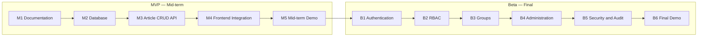

# Product Requirements Document (PRD) — DocHub

| Field        | Value                                                                      |
| ------------ | -------------------------------------------------------------------------- |
| Product      | DocHub                                                                     |
| Version      | MVP + Beta                                                                 |
| Releases     | MVP — Mid-term, Beta — Final                                               |
| Status       | Draft                                                                      |
| Related docs | Software Requirements Specification (SRS), Technical Design Document (TDD) |

This document covers both releases. Every goal, feature, and user story includes a Release column to distinguish the core platform from the advanced functionality.

## Documents in this set

| Short form | Full form                           | Purpose                                                  | File     |
| ---------- | ----------------------------------- | -------------------------------------------------------- | -------- |
| PRD        | Product Requirements Document       | What we build and why (this document)                    | `prd.md` |
| SRS        | Software Requirements Specification | Exact requirements, permissions, and acceptance criteria | `srs.md` |
| TDD        | Technical Design Document           | How we build it: architecture, data model, and API       | `tdd.md` |

## 0. Release plan

| Release | When     | Focus                                                                                                                       |
| ------- | -------- | --------------------------------------------------------------------------------------------------------------------------- |
| MVP     | Mid-term | Core documentation platform: article CRUD, categories, database integration, REST API, frontend integration                 |
| Beta    | Final    | Multi-user platform: JWT authentication, RBAC, group functionality, administration, moderation, audit logging, and security |

### Release workflow

## 1. Purpose

DocHub is an internal knowledge-sharing platform designed to centralize documentation and make organizational knowledge easier to create, organize, access, and maintain.

The platform allows users to create documentation articles, organize them using categories, and collaborate through group functionality. Administrators can manage users, moderate content, and monitor important platform activities.

The project is developed in two major releases:

**MVP (Mid-term):** Build the core documentation platform with article creation, retrieval, updating, deletion, category management, database persistence, and a functional React frontend connected to a FastAPI REST API.

**Beta (Final):** Extend the platform with user accounts, JWT authentication, role-based access control, group functionality, administrative management, content moderation, session management, audit logging, and security monitoring.

## 2. Problem statement

Students, developers, and teams need a centralized place to store and share technical knowledge, project documentation, guides, and useful information.

When documentation is scattered across different files and communication platforms, several problems occur:

- Important technical information becomes difficult to find.
- Documentation may become outdated or duplicated.
- Users have difficulty maintaining shared knowledge.
- There is no centralized way to manage users and content.
- Unauthorized users may access or modify resources.
- Administrators have limited visibility into platform activity and security events.

DocHub addresses these problems by providing a centralized knowledge-sharing platform with article management, categories, groups, authentication, authorization, and administrative tools.

## 3. Goals

| ID   | Goal                                                                                         | Release |
| ---- | -------------------------------------------------------------------------------------------- | ------- |
| G-1  | Provide a web-based platform for creating and managing documentation.                        | MVP     |
| G-2  | Implement REST APIs for article CRUD operations using FastAPI.                               | MVP     |
| G-3  | Store application data in Supabase PostgreSQL.                                               | MVP     |
| G-4  | Organize documentation using categories.                                                     | MVP     |
| G-5  | Provide a React and TypeScript frontend connected to the backend API.                        | MVP     |
| G-6  | Provide automatically generated API documentation at `/api/docs`.                            | MVP     |
| G-7  | Deploy the frontend using Vercel.                                                            | MVP     |
| G-8  | Provide user registration and JWT-based authentication.                                      | Beta    |
| G-9  | Control access using the global roles `user` and `admin`.                                    | Beta    |
| G-10 | Enforce resource ownership and permission checks.                                            | Beta    |
| G-11 | Support group creation, membership, and group-based access.                                  | Beta    |
| G-12 | Provide administrators with user-management and moderation functionality.                    | Beta    |
| G-13 | Track authentication sessions and support session revocation.                                | Beta    |
| G-14 | Maintain audit logs and failed-login records for security monitoring.                        | Beta    |
| G-15 | Protect accounts and application data through secure password handling and token validation. | Beta    |

## 4. Target users

| User                  | Need                                                                                     | Release    |
| --------------------- | ---------------------------------------------------------------------------------------- | ---------- |
| User                  | Read documentation and perform permitted article and group operations.                   | MVP / Beta |
| Article author        | Create and manage articles according to ownership and permissions.                       | MVP / Beta |
| Frontend developer    | Use a documented API to integrate the frontend.                                          | MVP        |
| Instructor / reviewer | Access the application and test endpoints through `/api/docs`.                           | MVP        |
| Admin                 | Manage users, change roles, ban accounts, moderate content, and inspect system activity. | Beta       |
| Group member          | Participate in group activities and access resources according to permissions.           | Beta       |
| Group creator         | Create and manage groups according to the application's permission rules.                | Beta       |

### Account roles

DocHub has only two global account roles:

| Role    | Description                                                                                                     |
| ------- | --------------------------------------------------------------------------------------------------------------- |
| `user`  | Standard authenticated account that can access functionality allowed by its permissions and resource ownership. |
| `admin` | Administrative account with access to authorized user-management, moderation, and system-management operations. |

Group membership and resource ownership are separate from global account roles. They do not introduce additional account roles such as `owner`, `editor`, or `member`.

## 5. Scope

### In scope — MVP (Mid-term)

- Create documentation articles.
- List and retrieve articles.
- View individual article details.
- Update existing articles.
- Delete articles.
- Associate articles with authors and categories.
- Manage documentation categories.
- Validate API request data.
- Return appropriate HTTP status codes and error responses.
- Store application data in Supabase PostgreSQL.
- Provide a React and TypeScript frontend.
- Connect frontend requests to the FastAPI backend.
- Provide interactive API documentation at `/api/docs`.
- Provide a backend health-check endpoint.
- Deploy the frontend using Vercel.

### In scope — Beta (Final)

**Authentication and accounts**

- User registration.
- User login and logout.
- JWT access-token authentication.
- Refresh-token handling and rotation.
- User profile retrieval.
- Authentication session tracking.
- Session revocation.

**User management**

- Maintain user profiles.
- Support global roles `user` and `admin`.
- List and inspect users.
- Change user roles.
- Ban and unban users.
- Revoke a user's active sessions.

**Article management and authorization**

- Authenticated article operations.
- Article ownership enforcement.
- Permission-based article access.
- Article statuses: `draft`, `review`, and `published`.
- Administrative article moderation.
- Administrative article deletion.

**Groups**

- Group creation and management.
- Group membership management.
- Group-based access restrictions.
- Permission checks for group operations.
- Administrative group moderation.

**Administration**

- Administrative dashboard.
- User and platform statistics.
- User search and filtering.
- User detail inspection.
- Article moderation.
- Group moderation.
- Audit-log inspection.
- Failed-login inspection.
- CSV export of supported administrative data.

**Security and auditing**

- Secure password hashing.
- Password pepper configuration.
- JWT signature and expiration validation.
- Refresh-session validation and revocation.
- Role and permission checks.
- Resource ownership checks.
- Banned-account restrictions.
- Audit logging.
- Failed-login monitoring.
- Environment-based secret management.

### Out of scope for this project

- Native Android and iOS applications.
- Real-time collaborative article editing.
- Offline documentation synchronization.
- External enterprise identity-provider integration.
- Social login.
- Automated email verification.
- Password-reset email workflow.
- Advanced AI-generated documentation.
- Automated document translation.
- Advanced notification systems.
- Advanced article version history.
- Advanced analytics beyond the implemented administrative dashboard.

## 6. Features and priority (MoSCoW)

Priorities are per release. A Beta "Must" is required for the final release, not necessarily for the mid-term.

| ID   | Feature                                             | Release | Priority |
| ---- | --------------------------------------------------- | ------- | -------- |
| F-1  | Create documentation article                        | MVP     | Must     |
| F-2  | List and retrieve articles                          | MVP     | Must     |
| F-3  | Get individual article by ID                        | MVP     | Must     |
| F-4  | Update article information and content              | MVP     | Must     |
| F-5  | Delete article                                      | MVP     | Must     |
| F-6  | Article input validation and error responses        | MVP     | Must     |
| F-7  | Category management                                 | MVP     | Must     |
| F-8  | Associate articles with categories and authors      | MVP     | Must     |
| F-9  | Supabase PostgreSQL integration                     | MVP     | Must     |
| F-10 | React and TypeScript frontend integration           | MVP     | Must     |
| F-11 | Backend health-check endpoint                       | MVP     | Must     |
| F-12 | API documentation at `/api/docs`                    | MVP     | Must     |
| F-13 | Frontend deployment using Vercel                    | MVP     | Must     |
| F-14 | User registration and login                         | Beta    | Must     |
| F-15 | JWT access-token authentication                     | Beta    | Must     |
| F-16 | Refresh-token handling and logout                   | Beta    | Must     |
| F-17 | User profile retrieval and account management       | Beta    | Should   |
| F-18 | Global roles: `user` and `admin`                    | Beta    | Must     |
| F-19 | RBAC and permission checks                          | Beta    | Must     |
| F-20 | Article ownership and access restrictions           | Beta    | Must     |
| F-21 | Article statuses: draft, review, published          | Beta    | Must     |
| F-22 | Group creation and membership management            | Beta    | Must     |
| F-23 | Group-based access and permission enforcement       | Beta    | Must     |
| F-24 | Administrative dashboard and statistics             | Beta    | Should   |
| F-25 | Admin user listing, inspection, and role management | Beta    | Must     |
| F-26 | User ban and unban functionality                    | Beta    | Must     |
| F-27 | User session revocation                             | Beta    | Must     |
| F-28 | Administrative article moderation                   | Beta    | Must     |
| F-29 | Administrative group moderation                     | Beta    | Should   |
| F-30 | Audit logging of important activities               | Beta    | Must     |
| F-31 | Failed-login monitoring                             | Beta    | Should   |
| F-32 | CSV export of supported administrative data         | Beta    | Should   |
| F-33 | Secure password hashing and pepper configuration    | Beta    | Must     |
| F-34 | JWT signature, expiration, and session validation   | Beta    | Must     |
| F-35 | Security restrictions for banned accounts           | Beta    | Must     |
| F-36 | Administrative search and filtering                 | Beta    | Should   |
| F-37 | Administrative user-detail view                     | Beta    | Should   |
| F-38 | Administrative bulk operations                      | Beta    | Could    |
| F-39 | Advanced article version history                    | Future  | Could    |
| F-40 | Real-time collaborative editing                     | Future  | Could    |
| F-41 | Advanced notifications and analytics                | Future  | Could    |

## 7. User stories

### MVP

| ID    | Story                                                                                                        | Feature  |
| ----- | ------------------------------------------------------------------------------------------------------------ | -------- |
| US-01 | As a user, I want to create an article so I can share useful knowledge.                                      | F-1      |
| US-02 | As a user, I want to see available articles so I can discover documentation.                                 | F-2      |
| US-03 | As a user, I want to open an individual article so I can read its full content.                              | F-3      |
| US-04 | As an article author, I want to update my article so I can correct or improve its content.                   | F-4      |
| US-05 | As an authorized user, I want to delete an article so outdated information can be removed.                   | F-5      |
| US-06 | As a user, I want invalid article data to be rejected with a clear error message.                            | F-6      |
| US-07 | As a user, I want articles organized by categories so documentation is easier to navigate.                   | F-7, F-8 |
| US-08 | As a maintainer, I want application data stored in a database so it survives application restarts.           | F-9      |
| US-09 | As a user, I want a frontend interface so I can use the platform without directly calling API endpoints.     | F-10     |
| US-10 | As a maintainer, I want a health endpoint so I can check whether the backend is running.                     | F-11     |
| US-11 | As a developer or reviewer, I want interactive API documentation so I can inspect and test endpoints.        | F-12     |
| US-12 | As an instructor or reviewer, I want to access the deployed application so I can evaluate its functionality. | F-13     |

### Beta

| ID    | Story                                                                                                                        | Feature    |
| ----- | ---------------------------------------------------------------------------------------------------------------------------- | ---------- |
| US-13 | As a visitor, I want to register with my account information so I can use the platform.                                      | F-14       |
| US-14 | As a registered user, I want to log in so I can access protected functionality.                                              | F-14, F-15 |
| US-15 | As a user, I want to log out so my authentication session is ended.                                                          | F-16       |
| US-16 | As a user, I want my access token renewed through a refresh mechanism so I do not need to log in repeatedly.                 | F-16       |
| US-17 | As a user, I want to view my profile so I can see my account information.                                                    | F-17       |
| US-18 | As an admin, I want to assign `user` or `admin` roles so I can control administrative access.                                | F-18, F-19 |
| US-19 | As a user, I want protected operations to check my permissions so unauthorized actions are prevented.                        | F-19       |
| US-20 | As an article author, I want my articles associated with my account so ownership can be enforced.                            | F-20       |
| US-21 | As an authorized user, I want article statuses to represent their publication state so content can be managed appropriately. | F-21       |
| US-22 | As a user, I want to create a group so I can collaborate with other users.                                                   | F-22       |
| US-23 | As a user, I want to manage group membership according to my permissions so group access remains controlled.                 | F-22, F-23 |
| US-24 | As a group member, I want to access group resources according to my permissions so I can participate in collaboration.       | F-23       |
| US-25 | As an admin, I want to view dashboard statistics so I can monitor platform activity.                                         | F-24       |
| US-26 | As an admin, I want to list and inspect users so I can manage accounts.                                                      | F-25       |
| US-27 | As an admin, I want to change a user's role so I can control their access level.                                             | F-25       |
| US-28 | As an admin, I want to ban a user with a reason so restricted accounts cannot continue using protected functionality.        | F-26       |
| US-29 | As an admin, I want to unban a user so I can restore access when appropriate.                                                | F-26       |
| US-30 | As an admin, I want to revoke a user's sessions so their existing authentication sessions become invalid.                    | F-27       |
| US-31 | As an admin, I want to moderate articles so inappropriate or unwanted content can be handled.                                | F-28       |
| US-32 | As an admin, I want to moderate groups so the platform remains properly managed.                                             | F-29       |
| US-33 | As an admin, I want to inspect audit logs so I can review important system activities.                                       | F-30       |
| US-34 | As an admin, I want to inspect failed-login records so I can identify suspicious authentication activity.                    | F-31       |
| US-35 | As an admin, I want to export supported records as CSV so I can review them outside the application.                         | F-32       |
| US-36 | As a user, I want my password stored securely so my credentials are protected.                                               | F-33       |
| US-37 | As a user, I want expired, invalid, and revoked tokens rejected so unauthorized requests cannot access protected resources.  | F-34       |
| US-38 | As an admin, I want banned accounts blocked from protected operations so account restrictions are enforced.                  | F-35       |
| US-39 | As an admin, I want to filter administrative records so I can find relevant users and content.                               | F-36       |
| US-40 | As an admin, I want to inspect an individual user's details so I can investigate account issues.                             | F-37       |

## 8. Success metrics

### MVP

- Article creation, retrieval, updating, and deletion work through the REST API.
- Article data is stored in Supabase PostgreSQL.
- Data persists after application restarts and redeployments.
- Articles can be associated with categories and authors.
- The frontend communicates successfully with the backend.
- `/api/docs` exposes the API documentation.
- `/health` provides a backend health response.
- The deployed frontend is accessible for demonstration.

### Beta

- Users can register and authenticate successfully.
- Protected endpoints reject unauthenticated requests.
- Invalid, expired, and revoked tokens are rejected.
- A regular `user` cannot perform `admin`-only operations.
- Article ownership and group permissions are enforced.
- Users cannot access group resources without the necessary permissions.
- Banned users cannot continue using protected functionality.
- Revoked sessions cannot be used for subsequent authenticated requests.
- Administrators can manage users and moderate articles and groups.
- Audit logs and failed-login records are available to authorized administrators.
- Passwords are never stored or returned in plaintext.
- Sensitive application secrets are not committed to source control.

## 9. Assumptions and constraints

- Frontend: React, TypeScript, and Vite.
- Backend: Python and FastAPI.
- Database: Supabase PostgreSQL.
- Database operations use the Supabase Python client, not SQLAlchemy ORM.
- Frontend and backend communicate through REST APIs using HTTP and JSON.
- Frontend API requests use the Axios service layer.
- Frontend deployment uses Vercel.
- Backend deployment requires a compatible Python hosting environment or an explicitly configured serverless deployment.
- API documentation is generated by FastAPI.
- Environment variables store database credentials and security secrets.
- User IDs use UUIDs.
- Article IDs use PostgreSQL `BIGINT` (`int8`).
- The only global account roles are `user` and `admin`.
- Group membership and resource ownership are handled through permission checks, not additional global roles.
- Article statuses are `draft`, `review`, and `published`.
- The first administrator must be provisioned through a controlled administrative process.
- The actual Supabase database schema is the source of truth for table columns and relationships.

## 10. Milestones

### MVP — Mid-term

| Milestone          | Deliverable                                                                |
| ------------------ | -------------------------------------------------------------------------- |
| M1 — Documentation | PRD, SRS, and TDD covering the project scope                               |
| M2 — Database      | Supabase PostgreSQL setup and core application tables                      |
| M3 — Backend API   | FastAPI application with article and category operations                   |
| M4 — Frontend      | React and TypeScript interface integrated with the REST API                |
| M5 — Validation    | Request validation, error handling, health endpoint, and API documentation |
| M6 — Mid-term Demo | Working documentation platform available for demonstration                 |

### Beta — Final

| Milestone               | Deliverable                                                                              |
| ----------------------- | ---------------------------------------------------------------------------------------- |
| B1 — Authentication     | Registration, login, JWT access tokens, refresh handling, logout, and session management |
| B2 — RBAC               | `user` and `admin` roles, permission checks, and ownership checks                        |
| B3 — Groups             | Group creation, membership management, and group-level access restrictions               |
| B4 — Administration     | Admin dashboard, user management, role changes, banning, and session revocation          |
| B5 — Moderation         | Article and group moderation functionality                                               |
| B6 — Security and Audit | Password security, token validation, audit logs, and failed-login monitoring             |
| B7 — Final Demo         | Integrated DocHub Beta available for final demonstration                                 |

## 11. Release dependencies

The Beta builds on the MVP's documentation and database functionality.

The core article and category APIs remain part of the platform. The Beta extends them with authentication, resource ownership, and permission enforcement.

The main dependencies are:

1. **Database before CRUD:** Article and category operations require the database schema and Supabase connection.
2. **Backend before frontend integration:** The frontend requires working REST API endpoints.
3. **Authentication before RBAC:** The backend must identify the authenticated user before enforcing user-specific permissions.
4. **RBAC before protected resources:** Article ownership and group access restrictions depend on the authorization layer.
5. **Groups before group moderation:** Administrative group operations depend on group functionality.
6. **Authentication sessions before session administration:** Session revocation depends on tracked authentication sessions.
7. **Audit infrastructure before audit reporting:** Administrative activity must be recorded before it can be inspected.

The final product uses the same core architecture: React frontend, FastAPI backend, and Supabase PostgreSQL database. The Beta extends the core documentation platform with authentication, authorization, collaboration, administration, and security capabilities.
