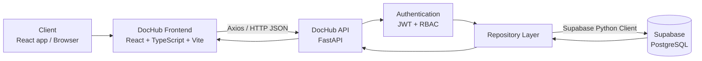
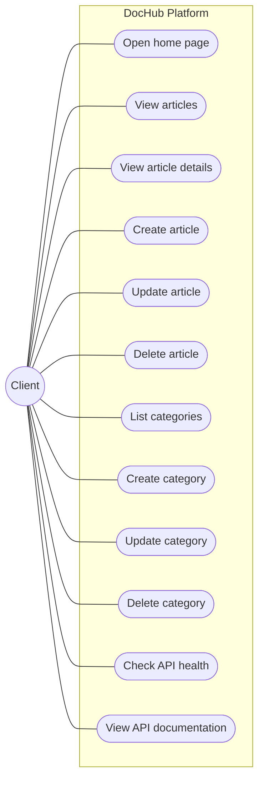
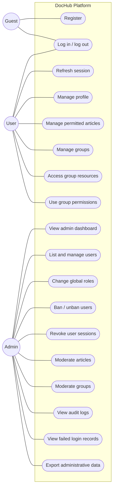

# Software Requirements Specification (SRS) — DocHub

| Field        | Value                                                                |
| ------------ | -------------------------------------------------------------------- |
| Product      | DocHub                                                               |
| Version      | MVP + Beta                                                           |
| Releases     | MVP — Mid-term, Beta — Final                                         |
| Status       | Draft                                                                |
| Related docs | Product Requirements Document (PRD), Technical Design Document (TDD) |

Every requirement has a Release column: MVP is built for the mid-term, Beta is added for the final.

## Documents in this set

| Short form | Full form                           | Purpose                                                                 | File     |
| ---------- | ----------------------------------- | ----------------------------------------------------------------------- | -------- |
| PRD        | Product Requirements Document       | What we build and why                                                   | `prd.md` |
| SRS        | Software Requirements Specification | Exact requirements, permissions and acceptance criteria (this document) | `srs.md` |
| TDD        | Technical Design Document           | How we build it: architecture, data model, API                          | `tdd.md` |

# 1. Introduction

## 1.1 Purpose

This document defines the software requirements for DocHub, an internal knowledge-sharing and documentation management platform.

It describes the MVP, which provides core documentation and category management, and the Beta, which adds authentication, authorization, group collaboration, administration, moderation and security features.

The document serves as a reference for implementation, testing, and project evaluation.

## 1.2 Scope

**MVP:** Users can access the DocHub interface and manage documentation articles and categories through REST APIs. Articles are stored in Supabase PostgreSQL and can be created, listed, viewed, updated and deleted through the application.

**Beta:** Users can register and log in, manage their accounts, access authorized articles, participate in groups and use group-level permissions. Administrators can manage users, change global roles, ban and unban accounts, revoke sessions, moderate articles and groups, inspect audit logs and monitor security events.

DocHub has exactly two global account roles:

- `user` — a normal authenticated account.
- `admin` — an account with administrative privileges.

Group membership and group-level permissions are separate from global account roles.

Out of scope: see PRD, section 5.

## 1.3 Definitions

| Term                   | Meaning                                                                                               |
| ---------------------- | ----------------------------------------------------------------------------------------------------- |
| CRUD                   | Create, Read, Update, Delete                                                                          |
| REST                   | API style where resources are accessed using HTTP methods such as GET, POST, PATCH and DELETE         |
| Article                | A documentation entry containing a title, content and associated information                          |
| Category               | A classification used to organize documentation articles                                              |
| User                   | A registered DocHub account with the global role `user`                                               |
| Admin                  | A registered DocHub account with the global role `admin`                                              |
| Group                  | A collaborative space where users can access shared resources according to membership and permissions |
| Group membership       | A relationship between a user and a group                                                             |
| Group permission       | An authorization rule controlling what a group member can do                                          |
| RBAC                   | Role-Based Access Control: access is restricted according to a user's global role                     |
| JWT                    | JSON Web Token: a signed token used to authenticate a caller                                          |
| Access token           | A short-lived JWT sent in the Authorization: Bearer header                                            |
| Refresh token          | A token used to obtain a new access token                                                             |
| Authentication session | A tracked login session that can be revoked                                                           |
| Ownership              | A relationship identifying the user responsible for a resource                                        |
| Audit log              | A record of important application or administrative activities                                        |
| Repository             | Backend module responsible for database operations                                                    |
| API                    | Application Programming Interface                                                                     |
| OpenAPI                | Standard API description generated by FastAPI                                                         |
| Supabase               | Backend platform providing PostgreSQL database services                                               |
| Client                 | Anything that sends requests to the API, such as the React frontend, browser, curl or Postman         |

# 2. Overall description

## 2.1 System context

DocHub uses a three-layer client-server architecture.

The frontend communicates with the FastAPI backend using Axios. The backend validates requests, performs authentication and authorization checks, and accesses PostgreSQL through the Supabase Python client.

## 2.2 Users and roles

| Account type    | Release | Description                                                                                                                                       |
| --------------- | ------- | ------------------------------------------------------------------------------------------------------------------------------------------------- |
| Guest           | Beta    | Not logged in; can only sign up, log in, check health and read the API docs.                                                                      |
| User (`user`)   | Beta    | A registered account that can access normal platform functionality, manage permitted articles and participate in groups according to permissions. |
| Admin (`admin`) | Beta    | An account with additional administrative privileges, including user management, moderation, security monitoring and administrative reporting.    |
| Group owner     | Beta    | Per-group role of the user who created the group: rename/delete the group, add/remove members                                                     |
| Group member    | Beta    | Per-group role: view, create and update the group's tasks                                                                                         |

**Global role rules**

- Every registered account has exactly one global role: `user` or `admin`.
- A newly registered account receives the `user` role.
- An administrator can change another user's global role.
- A normal user cannot access administrator-only endpoints.
- Group membership and permissions do not create additional global account roles.
- Group permissions are checked separately from global role checks.

## 2.3 Use cases

### MVP

### Beta

Every admin is also an authenticated account. An admin can use normal application functionality as permitted by the system. Group access is still subject to group membership and group-level permission checks.

## 2.4 Constraints

| ID   | Constraint                                                                      |
| ---- | ------------------------------------------------------------------------------- |
| C-1  | The frontend must use React and TypeScript with Vite.                           |
| C-2  | The backend must use Python and FastAPI.                                        |
| C-3  | The database must use Supabase PostgreSQL.                                      |
| C-4  | Database operations must use the Supabase Python client.                        |
| C-5  | SQLAlchemy ORM is not used in the project.                                      |
| C-6  | Frontend-backend communication must use REST APIs.                              |
| C-7  | API request and response data must use JSON where applicable.                   |
| C-8  | The frontend must communicate with the backend through the Axios service layer. |
| C-9  | The global account roles are limited to `user` and `admin`.                     |
| C-10 | Authentication must use signed JWT tokens.                                      |
| C-11 | Sensitive configuration must be stored in environment variables.                |
| C-12 | The frontend is deployed through Vercel.                                        |
| C-13 | Backend authorization must be enforced independently of frontend visibility.    |

## 2.5 Assumptions

| ID  | Assumption                                                                                   |
| --- | -------------------------------------------------------------------------------------------- |
| A-1 | A Supabase project and PostgreSQL database are available to the backend.                     |
| A-2 | The required database tables and relationships have been created.                            |
| A-3 | The backend receives valid Supabase configuration through environment variables.             |
| A-4 | The frontend has the correct backend API URL configured.                                     |
| A-5 | Users access DocHub through a modern web browser.                                            |
| A-6 | The first administrator account is provisioned through a controlled process.                 |
| A-7 | Users have internet access to use the hosted application.                                    |
| A-8 | Application traffic is expected to be relatively low during the academic project evaluation. |

# 3. Functional requirements

## 3.1 Articles — MVP

| ID    | Requirement                                                                                  | Release | Story               |
| ----- | -------------------------------------------------------------------------------------------- | ------- | ------------------- |
| FR-01 | The system shall allow an article to be created with the required article information.       | MVP     | US-01               |
| FR-02 | The system shall store created articles in Supabase PostgreSQL.                              | MVP     | US-01               |
| FR-03 | The system shall return a list of available articles.                                        | MVP     | US-02               |
| FR-04 | The system shall return an individual article using its ID.                                  | MVP     | US-03               |
| FR-05 | The system shall allow an existing article to be updated.                                    | MVP     | US-04               |
| FR-06 | The system shall allow an article to be deleted.                                             | MVP     | US-05               |
| FR-07 | The system shall associate an article with its author where author information is available. | MVP     | US-01               |
| FR-08 | The system shall associate an article with a category where applicable.                      | MVP     | US-01               |
| FR-09 | The system shall return an appropriate error when an article does not exist.                 | MVP     | US-03, US-04, US-05 |
| FR-10 | The system shall validate article input before performing database operations.               | MVP     | US-01, US-04        |
| FR-11 | The system shall return article information through JSON API responses.                      | MVP     | US-02, US-03        |
| FR-12 | The system shall support the article statuses `draft`, `review` and `published`.             | Beta    | US-10               |

## 3.2 Categories — MVP

| ID    | Requirement                                                                | Release | Story |
| ----- | -------------------------------------------------------------------------- | ------- | ----- |
| FR-13 | The system shall allow categories to be created.                           | MVP     | US-06 |
| FR-14 | The system shall return a list of available categories.                    | MVP     | US-06 |
| FR-15 | The system shall allow an existing category to be updated.                 | MVP     | US-06 |
| FR-16 | The system shall allow a category to be deleted.                           | MVP     | US-06 |
| FR-17 | The system shall validate category information before database operations. | MVP     | US-06 |
| FR-18 | The system shall allow articles to reference categories.                   | MVP     | US-01 |

## 3.3 API and system health — MVP

| ID    | Requirement                                                                            | Release | Story       |
| ----- | -------------------------------------------------------------------------------------- | ------- | ----------- |
| FR-19 | The system shall expose REST API endpoints for article operations.                     | MVP     | US-01–US-05 |
| FR-20 | The system shall expose REST API endpoints for category operations.                    | MVP     | US-06       |
| FR-21 | The system shall provide a root endpoint returning API information and running status. | MVP     | US-07       |
| FR-22 | The system shall provide a health-check endpoint returning the backend health status.  | MVP     | US-07       |
| FR-23 | The system shall publish interactive API documentation at `/api/docs`.                 | MVP     | US-08       |
| FR-24 | The system shall publish its OpenAPI specification at `/api/openapi.json`.             | MVP     | US-08       |
| FR-25 | The system shall handle invalid requests using appropriate HTTP status codes.          | MVP     | US-08       |

## 3.4 Authentication and sessions — Beta

| ID    | Requirement                                                                                                                | Release | Story |
| ----- | -------------------------------------------------------------------------------------------------------------------------- | ------- | ----- |
| FR-26 | The system shall allow a guest to register an account using the required registration information.                         | Beta    | US-09 |
| FR-27 | Every newly registered account shall receive the global role `user`.                                                       | Beta    | US-09 |
| FR-28 | The system shall authenticate a registered account using its credentials.                                                  | Beta    | US-09 |
| FR-29 | The system shall issue a signed JWT access token after successful authentication.                                          | Beta    | US-09 |
| FR-30 | The system shall verify the JWT signature and expiration before accepting protected requests.                              | Beta    | US-10 |
| FR-31 | The system shall support refresh-token operations for obtaining new access tokens.                                         | Beta    | US-10 |
| FR-32 | The system shall rotate refresh tokens during the refresh process.                                                         | Beta    | US-10 |
| FR-33 | The system shall maintain authentication-session information.                                                              | Beta    | US-10 |
| FR-34 | The system shall support logout by revoking the relevant authentication session.                                           | Beta    | US-10 |
| FR-35 | The system shall reject revoked or invalid authentication sessions.                                                        | Beta    | US-10 |
| FR-36 | The system shall prevent banned accounts from accessing protected functionality.                                           | Beta    | US-11 |
| FR-37 | The system shall provide authenticated user information without exposing password hashes or sensitive authentication data. | Beta    | US-09 |

## 3.5 User profiles — Beta

| ID    | Requirement                                                                                                          | Release | Story |
| ----- | -------------------------------------------------------------------------------------------------------------------- | ------- | ----- |
| FR-38 | The system shall maintain a user profile containing the user's basic account information.                            | Beta    | US-12 |
| FR-39 | The system shall allow an authenticated user to access permitted profile information.                                | Beta    | US-12 |
| FR-40 | The system shall allow authorized profile information to be updated according to backend validation and permissions. | Beta    | US-12 |
| FR-41 | The system shall prevent unauthorized users from modifying another user's profile.                                   | Beta    | US-12 |
| FR-42 | The system shall maintain the user's global role as either `user` or `admin`.                                        | Beta    | US-13 |

## 3.6 Roles and authorization — Beta

| ID    | Requirement                                                                                          | Release | Story       |
| ----- | ---------------------------------------------------------------------------------------------------- | ------- | ----------- |
| FR-43 | Every registered account shall have exactly one global role: `user` or `admin`.                      | Beta    | US-13       |
| FR-44 | The system shall restrict administrative endpoints to accounts with the `admin` role.                | Beta    | US-13       |
| FR-45 | The system shall reject requests from normal users when they attempt to access admin-only endpoints. | Beta    | US-13       |
| FR-46 | The system shall enforce resource ownership before allowing protected article operations.            | Beta    | US-14       |
| FR-47 | The system shall check group membership before allowing access to restricted group resources.        | Beta    | US-15       |
| FR-48 | The system shall enforce group-level permissions for supported group operations.                     | Beta    | US-15       |
| FR-49 | The system shall perform authorization checks on the backend for every protected operation.          | Beta    | US-13–US-15 |
| FR-50 | The system shall not rely only on frontend visibility or disabled controls to enforce permissions.   | Beta    | US-13–US-15 |

## 3.7 Groups and group permissions — Beta

| ID    | Requirement                                                                                          | Release | Story        |
| ----- | ---------------------------------------------------------------------------------------------------- | ------- | ------------ |
| FR-51 | The system shall allow authenticated users to create groups.                                         | Beta    | US-16        |
| FR-52 | The system shall maintain group information in the database.                                         | Beta    | US-16        |
| FR-53 | The system shall maintain group membership information.                                              | Beta    | US-16        |
| FR-54 | The system shall allow users to access groups according to their membership.                         | Beta    | US-16        |
| FR-55 | The system shall allow authorized group operations according to group-level permissions.             | Beta    | US-17        |
| FR-56 | The system shall prevent non-members from accessing restricted group resources.                      | Beta    | US-17        |
| FR-57 | The system shall enforce group permissions independently of the user's global account role.          | Beta    | US-17        |
| FR-58 | The system shall support group-related operations through dedicated backend routes and repositories. | Beta    | US-16, US-17 |

## 3.8 Administration — Beta

| ID    | Requirement                                                                                            | Release | Story       |
| ----- | ------------------------------------------------------------------------------------------------------ | ------- | ----------- |
| FR-59 | The system shall provide an administrative dashboard accessible only to admins.                        | Beta    | US-18       |
| FR-60 | The dashboard shall display the total number of users.                                                 | Beta    | US-18       |
| FR-61 | The dashboard shall display the number of banned users.                                                | Beta    | US-18       |
| FR-62 | The dashboard shall display the total number of records and groups.                                    | Beta    | US-18       |
| FR-63 | The dashboard shall display new-user, new-record and new-group statistics for the previous seven days. | Beta    | US-18       |
| FR-64 | The system shall allow admins to list registered users.                                                | Beta    | US-19       |
| FR-65 | The system shall support user search and available role and status filters.                            | Beta    | US-19       |
| FR-66 | The system shall allow admins to view individual user information.                                     | Beta    | US-19       |
| FR-67 | The system shall allow admins to change another user's global role.                                    | Beta    | US-20       |
| FR-68 | The system shall allow admins to ban a user account.                                                   | Beta    | US-20       |
| FR-69 | The system shall allow admins to store a ban reason where provided.                                    | Beta    | US-20       |
| FR-70 | The system shall allow admins to unban a previously banned account.                                    | Beta    | US-20       |
| FR-71 | The system shall allow admins to revoke a user's authentication sessions.                              | Beta    | US-20       |
| FR-72 | The system shall prevent unauthorized accounts from performing administrative operations.              | Beta    | US-18–US-20 |

## 3.9 Content and group moderation — Beta

| ID    | Requirement                                                                       | Release | Story        |
| ----- | --------------------------------------------------------------------------------- | ------- | ------------ |
| FR-73 | The system shall allow admins to view articles requiring moderation.              | Beta    | US-21        |
| FR-74 | The system shall allow admins to change article moderation status.                | Beta    | US-21        |
| FR-75 | The system shall allow admins to delete articles through moderation operations.   | Beta    | US-21        |
| FR-76 | The system shall allow admins to view groups for moderation.                      | Beta    | US-22        |
| FR-77 | The system shall allow admins to delete groups through administrative operations. | Beta    | US-22        |
| FR-78 | The system shall restrict moderation operations to admins.                        | Beta    | US-21, US-22 |

## 3.10 Audit logging and security monitoring — Beta

| ID    | Requirement                                                                                         | Release | Story        |
| ----- | --------------------------------------------------------------------------------------------------- | ------- | ------------ |
| FR-79 | The system shall record important application and administrative activities in audit logs.          | Beta    | US-23        |
| FR-80 | Audit records shall support information about the actor, action, target and relevant metadata.      | Beta    | US-23        |
| FR-81 | The system shall record relevant failed-login events.                                               | Beta    | US-24        |
| FR-82 | The system shall allow admins to view audit logs.                                                   | Beta    | US-23        |
| FR-83 | The system shall allow admins to inspect failed-login records.                                      | Beta    | US-24        |
| FR-84 | The system shall allow admins to export supported administrative data as CSV.                       | Beta    | US-25        |
| FR-85 | The system shall prevent normal users from accessing administrative audit and security information. | Beta    | US-23, US-24 |

## 3.11 Validation rules

| Field                | Rule                                                                       | Release |
| -------------------- | -------------------------------------------------------------------------- | ------- |
| Article title        | Required when creating an article; must satisfy backend schema validation. | MVP     |
| Article content      | Must satisfy the article schema and required content validation.           | MVP     |
| Article ID           | Must use the expected integer identifier format.                           | MVP     |
| Category name        | Must satisfy category schema validation.                                   | MVP     |
| User email           | Must satisfy the configured email validation rules.                        | Beta    |
| User name            | Must satisfy the configured profile validation rules.                      | Beta    |
| Password             | Must satisfy the configured password validation rules.                     | Beta    |
| Global role          | Must be either `user` or `admin`.                                          | Beta    |
| Article status       | Must be `draft`, `review` or `published`.                                  | Beta    |
| Group ID             | Must identify an existing group.                                           | Beta    |
| User ID              | Must identify an existing user profile.                                    | Beta    |
| Authentication token | Must be correctly signed and valid for the required operation.             | Beta    |

## 3.12 HTTP status codes

| Case                                         | Code                                    | Release    |
| -------------------------------------------- | --------------------------------------- | ---------- |
| Resource created                             | 201 Created                             | MVP / Beta |
| Read or update succeeded                     | 200 OK                                  | MVP / Beta |
| Resource deleted                             | 204 No Content, where configured        | MVP / Beta |
| Invalid input                                | 422 Unprocessable Content               | MVP / Beta |
| Resource not found                           | 404 Not Found                           | MVP / Beta |
| Missing or invalid authentication            | 401 Unauthorized                        | Beta       |
| Authenticated but not authorized             | 403 Forbidden                           | Beta       |
| Duplicate resource or conflicting operation  | 409 Conflict, where applicable          | Beta       |
| Too many requests or authentication attempts | 429 Too Many Requests, where configured | Beta       |
| Unexpected server error                      | 500 Internal Server Error               | MVP / Beta |

# 4. Non-functional requirements

| ID     | Category          | Requirement                                                                                                                   | Release |
| ------ | ----------------- | ----------------------------------------------------------------------------------------------------------------------------- | ------- |
| NFR-01 | Performance       | API operations should respond within a reasonable time under normal academic-project usage.                                   | MVP     |
| NFR-02 | Persistence       | Application data shall be stored in Supabase PostgreSQL and persist across application restarts and redeployments.            | MVP     |
| NFR-03 | Availability      | The deployed frontend and backend services should remain accessible when their hosting and database services are operational. | MVP     |
| NFR-04 | Usability         | The frontend shall provide a clear and understandable interface.                                                              | MVP     |
| NFR-05 | Compatibility     | The frontend and backend shall communicate using HTTP and JSON.                                                               | MVP     |
| NFR-06 | Maintainability   | Backend route handling and database operations shall be separated into route and repository modules.                          | MVP     |
| NFR-07 | API documentation | FastAPI shall generate interactive API documentation at `/api/docs`.                                                          | MVP     |
| NFR-08 | Security          | Sensitive configuration and credentials shall be stored in environment variables rather than committed to Git.                | MVP     |
| NFR-09 | Reliability       | Invalid requests shall return appropriate error responses instead of causing application failure.                             | MVP     |
| NFR-10 | Deployability     | The frontend shall support deployment through Vercel.                                                                         | MVP     |
| NFR-11 | Security          | Passwords shall be stored using secure password hashing, never plaintext.                                                     | Beta    |
| NFR-12 | Security          | Password pepper and authentication secrets shall be supplied through secure configuration.                                    | Beta    |
| NFR-13 | Security          | JWT access tokens shall be signed and verified using the configured signing algorithm.                                        | Beta    |
| NFR-14 | Security          | Protected endpoints shall validate token expiration and authentication-session status.                                        | Beta    |
| NFR-15 | Security          | Refresh-token rotation and revocation shall be supported.                                                                     | Beta    |
| NFR-16 | Security          | Banned accounts shall not be able to access protected functionality.                                                          | Beta    |
| NFR-17 | Authorization     | Every protected operation shall perform server-side role, ownership or permission checks as appropriate.                      | Beta    |
| NFR-18 | Privacy           | Password hashes, signing secrets and refresh-token secrets shall not be exposed in API responses.                             | Beta    |
| NFR-19 | Auditability      | Important administrative and security-related activities shall be recorded.                                                   | Beta    |
| NFR-20 | Maintainability   | Authentication and authorization logic shall be reusable across protected API routes.                                         | Beta    |
| NFR-21 | Scalability       | The application structure should support additional features without requiring major architectural changes.                   | Beta    |

# 5. Acceptance criteria

## MVP

### AC-01 Create article (FR-01, FR-02)

Given valid article information,

When a client sends a create-article request,

Then the system stores the article in Supabase PostgreSQL and returns the created article information.

### AC-02 List articles (FR-03)

Given that articles exist in the database,

When a client requests the article list,

Then the system returns the available articles in a JSON response.

### AC-03 View article (FR-04, FR-09)

Given an article exists,

When a client requests that article using its ID,

Then the system returns the article.

When the requested article does not exist,

Then the system returns 404.

### AC-04 Update article (FR-05, FR-10)

Given an existing article,

When a client sends valid updated article information,

Then the system updates the article and returns the updated information.

When the submitted information is invalid,

Then the system returns an appropriate validation error.

### AC-05 Delete article (FR-06)

Given an existing article,

When a client sends a delete request,

Then the system deletes the article.

A subsequent request for that article shall return 404.

### AC-06 Category management (FR-13–FR-18)

Given a valid category request,

When a client creates, lists, updates or deletes a category,

Then the system performs the requested operation and returns an appropriate response.

### AC-07 API health (FR-21, FR-22)

When a client requests the root or health endpoint,

Then the backend returns the configured API information or health status.

### AC-08 API documentation (FR-23, FR-24)

When a client opens `/api/docs`,

Then the interactive FastAPI documentation shall be displayed.

The OpenAPI specification shall be available at `/api/openapi.json`.

## Beta

### AC-09 User registration (FR-26, FR-27)

Given a guest submits valid registration information,

When the registration request is processed,

Then the system creates a user account with the global role `user`.

The response shall not expose the password or password hash.

### AC-10 User login (FR-28, FR-29)

Given a registered user submits valid credentials,

When the login request is processed,

Then the system authenticates the user and issues a signed JWT access token.

Invalid credentials shall not produce an authenticated session.

### AC-11 Token validation (FR-30, FR-35)

Given a protected API endpoint,

When a request contains a missing, invalid, expired or revoked token,

Then the system rejects the request with an appropriate authentication response.

### AC-12 Refresh session (FR-31, FR-32)

Given a valid refresh token,

When the user requests a token refresh,

Then the system issues a new access token and rotates the refresh token according to the authentication flow.

### AC-13 Logout (FR-33, FR-34)

Given an authenticated user,

When the user logs out,

Then the system revokes the relevant authentication session.

A revoked session shall not be accepted for refresh operations.

### AC-14 Global role enforcement (FR-43–FR-45)

Given a normal account with the role `user`,

When it attempts to access an admin-only endpoint,

Then the system returns 403.

Given an account with the role `admin`,

When it accesses an authorized admin endpoint,

Then the system allows the operation.

### AC-15 Article ownership (FR-46)

Given an article that belongs to another user,

When an unauthorized user attempts to modify or delete it,

Then the backend rejects the operation according to the ownership rules.

### AC-16 Group access (FR-47, FR-56)

Given a user who is not a member of a restricted group,

When the user attempts to access that group's protected resources,

Then the system rejects the request.

### AC-17 Group permissions (FR-48, FR-57)

Given a group member without the required permission,

When that member attempts a protected group operation,

Then the backend rejects the operation.

When the required permission is present,

Then the system allows the operation.

### AC-18 Admin dashboard (FR-59–FR-63)

Given an authenticated admin,

When the admin requests dashboard information,

Then the system returns the available platform statistics, including user, banned-user, record and group counts.

A normal user shall not be able to access the administrative dashboard endpoint.

### AC-19 User administration (FR-64–FR-67)

Given an authenticated admin,

When the admin lists users or inspects a user,

Then the system returns the permitted user information.

When the admin changes another user's global role,

Then the system updates that user's role to either `user` or `admin`.

### AC-20 Ban and unban (FR-68–FR-70)

Given an admin bans a user,

When the ban operation succeeds,

Then the system records the ban information and revokes the user's relevant authentication sessions.

The banned account shall be prevented from using protected functionality.

When the admin unbans the account,

Then the account shall be able to authenticate again, subject to normal authentication checks.

### AC-21 Session revocation (FR-71)

Given an admin requests revocation of another user's sessions,

When the operation succeeds,

Then the system revokes the user's tracked authentication sessions.

### AC-22 Article moderation (FR-73–FR-75)

Given an authenticated admin,

When the admin views or updates article moderation information,

Then the system performs the requested operation.

A normal user shall not be allowed to perform administrative moderation operations.

### AC-23 Group moderation (FR-76, FR-77)

Given an authenticated admin,

When the admin requests group moderation or deletion,

Then the system performs the operation according to the backend rules.

### AC-24 Audit logs (FR-79–FR-82)

Given important application or administrative activities have occurred,

When an admin requests the audit log,

Then the system returns the available audit records.

A normal user shall not be able to access the administrative audit endpoint.

### AC-25 Failed-login monitoring (FR-81, FR-83)

Given failed-login events have been recorded,

When an admin requests the security information,

Then the system returns the available failed-login records.

### AC-26 CSV export (FR-84)

Given an admin requests a supported data export,

When the export operation is processed,

Then the system returns the supported data in CSV format.

# 6. Permission matrix — Beta

| Action                                   | Guest | User                                        | Admin                                       |
| ---------------------------------------- | ----- | ------------------------------------------- | ------------------------------------------- |
| Register account                         | Yes   | —                                           | —                                           |
| Log in                                   | Yes   | Yes                                         | Yes                                         |
| Refresh authentication session           | No    | Yes                                         | Yes                                         |
| Log out                                  | No    | Yes                                         | Yes                                         |
| View permitted profile information       | No    | Yes                                         | Yes                                         |
| Update own permitted profile information | No    | Yes                                         | Yes                                         |
| Access normal article functionality      | No    | Yes, according to permissions               | Yes, according to permissions               |
| Create an article                        | No    | Yes, according to permissions               | Yes, according to permissions               |
| Update own article                       | No    | Yes, according to ownership and permissions | Yes, according to ownership and permissions |
| Delete own article                       | No    | Yes, according to ownership and permissions | Yes, according to ownership and permissions |
| Access restricted group resources        | No    | Only if a member                            | Only if a member                            |
| Perform group operations                 | No    | According to group permissions              | According to group permissions              |
| Access admin dashboard                   | No    | No (403)                                    | Yes                                         |
| List all users                           | No    | No (403)                                    | Yes                                         |
| Inspect user details                     | No    | No (403)                                    | Yes                                         |
| Change another user's global role        | No    | No (403)                                    | Yes                                         |
| Ban / unban users                        | No    | No (403)                                    | Yes                                         |
| Revoke another user's sessions           | No    | No (403)                                    | Yes                                         |
| View article moderation information      | No    | No (403)                                    | Yes                                         |
| Change article moderation status         | No    | No (403)                                    | Yes                                         |
| Delete articles through moderation       | No    | No (403)                                    | Yes                                         |
| View groups for moderation               | No    | No (403)                                    | Yes                                         |
| Delete groups through moderation         | No    | No (403)                                    | Yes                                         |
| View administrative audit logs           | No    | No (403)                                    | Yes                                         |
| View failed-login records                | No    | No (403)                                    | Yes                                         |
| Export supported administrative data     | No    | No (403)                                    | Yes                                         |

**Permission notes**

- `user` and `admin` are the only global account roles.
- An admin does not automatically become a member of every group.
- Group membership and group-level permissions determine access to restricted group resources.
- Ownership checks apply to resources where ownership is enforced.
- A normal user cannot gain administrative access by modifying frontend data or JWT payload contents.
- Backend authorization is authoritative.

# 7. Traceability

The following table maps the main user stories to requirements and API areas. Exact HTTP methods and paths are maintained in the backend route implementation and the TDD.

| Story | Requirements               | API area                                            | Release |
| ----- | -------------------------- | --------------------------------------------------- | ------- |
| US-01 | FR-01, FR-02, FR-07, FR-08 | `/api/articles`                                     | MVP     |
| US-02 | FR-03                      | `/api/articles`                                     | MVP     |
| US-03 | FR-04, FR-09               | `/api/articles/{article_id}`                        | MVP     |
| US-04 | FR-05, FR-10               | `/api/articles/{article_id}`                        | MVP     |
| US-05 | FR-06                      | `/api/articles/{article_id}`                        | MVP     |
| US-06 | FR-13–FR-18                | `/api/categories`                                   | MVP     |
| US-07 | FR-21, FR-22               | `/`, `/health`                                      | MVP     |
| US-08 | FR-23, FR-24, FR-25        | `/api/docs`, `/api/openapi.json`                    | MVP     |
| US-09 | FR-26–FR-29, FR-37         | `/api/auth`                                         | Beta    |
| US-10 | FR-30–FR-35                | `/api/auth`                                         | Beta    |
| US-11 | FR-36                      | Authentication and protected API routes             | Beta    |
| US-12 | FR-38–FR-41                | `/api/users`                                        | Beta    |
| US-13 | FR-42–FR-45                | `/api/admin` and RBAC dependencies                  | Beta    |
| US-14 | FR-46                      | Article routes and ownership checks                 | Beta    |
| US-15 | FR-47–FR-50                | Group routes and permission checks                  | Beta    |
| US-16 | FR-51–FR-54, FR-58         | `/api/groups`                                       | Beta    |
| US-17 | FR-55–FR-57                | Group routes and permission checks                  | Beta    |
| US-18 | FR-59–FR-63                | `GET /api/admin/dashboard`                          | Beta    |
| US-19 | FR-64–FR-66                | `/api/admin/users`                                  | Beta    |
| US-20 | FR-67–FR-72                | `/api/admin/users/{user_id}` and related operations | Beta    |
| US-21 | FR-73–FR-75                | `/api/admin/moderation/articles`                    | Beta    |
| US-22 | FR-76–FR-78                | `/api/admin/moderation/groups`                      | Beta    |
| US-23 | FR-79, FR-80, FR-82, FR-85 | `GET /api/admin/audit-logs`                         | Beta    |
| US-24 | FR-81, FR-83, FR-85        | `GET /api/admin/security/failed-logins`             | Beta    |
| US-25 | FR-84                      | `/api/admin/export/{table}.csv`                     | Beta    |

# 8. API endpoint overview

The following table identifies the main API areas. The exact route methods and schemas are defined by the FastAPI implementation.

| API area                            | Functionality                           |
| ----------------------------------- | --------------------------------------- |
| `/`                                 | Root API information                    |
| `/health`                           | Backend health check                    |
| `/api/docs`                         | Interactive API documentation           |
| `/api/openapi.json`                 | OpenAPI specification                   |
| `/api/auth`                         | Registration, login, refresh and logout |
| `/api/users`                        | User-related operations                 |
| `/api/articles`                     | Article management                      |
| `/api/categories`                   | Category management                     |
| `/api/groups`                       | Group and membership management         |
| `/api/admin/dashboard`              | Administrative dashboard statistics     |
| `/api/admin/users`                  | Administrative user management          |
| `/api/admin/moderation/articles`    | Article moderation                      |
| `/api/admin/moderation/groups`      | Group moderation                        |
| `/api/admin/audit-logs`             | Audit log access                        |
| `/api/admin/security/failed-logins` | Failed-login monitoring                 |
| `/api/admin/export/{table}.csv`     | Administrative CSV export               |

# 9. Data requirements

## 9.1 Main data entities

| Entity                  | Purpose                                                                    |
| ----------------------- | -------------------------------------------------------------------------- |
| Profiles                | Stores user profile information and global account roles.                  |
| Articles                | Stores documentation articles, authors, categories and status information. |
| Categories              | Stores categories used to organize articles.                               |
| Groups                  | Stores group information.                                                  |
| Group memberships       | Stores relationships between users and groups.                             |
| Authentication sessions | Stores tracked authentication-session information.                         |
| Audit logs              | Stores application and administrative activity records.                    |
| Login attempts          | Stores relevant failed-login information.                                  |

## 9.2 Data relationships

- Each profile has a UUID identifier.
- Each article has a BIGINT (`int8`) identifier.
- Each article can reference an author through the profile relationship.
- Articles can reference categories.
- Users can be associated with groups through membership records.
- Authentication sessions are associated with user accounts.
- Audit records store information about relevant actions and actors where available.

## 9.3 Data validation

- User identifiers shall follow the UUID format.
- Article identifiers shall follow the integer format.
- Required article information shall be validated before database operations.
- Category references shall identify valid categories.
- Global account roles shall be limited to `user` and `admin`.
- Article statuses shall be limited to `draft`, `review` and `published`.
- Protected operations shall validate ownership, membership and permissions as applicable.

# 10. Security requirements

## 10.1 Authentication

- Protected endpoints shall require valid authentication.
- Access tokens shall be signed JWTs.
- Token signatures and expiration shall be checked.
- Refresh-token operations shall support rotation.
- Authentication sessions shall be tracked.
- Revoked sessions shall not be accepted for refresh operations.

## 10.2 Authorization

- The system shall recognize only `user` and `admin` as global roles.
- Admin-only routes shall require the `admin` role.
- Article operations shall enforce ownership where applicable.
- Group operations shall enforce membership and group-level permissions.
- Authorization shall be performed on the backend.

## 10.3 Password and secret protection

- Passwords shall not be stored in plaintext.
- Password hashing shall be used.
- Password pepper shall be supplied through secure configuration.
- JWT signing secrets and refresh-token encryption keys shall be supplied through environment variables.
- Sensitive values shall not be exposed in API responses.
- Sensitive authentication information shall not be included in audit logs.

## 10.4 Account security

- Banned users shall be prevented from accessing protected functionality.
- Administrators shall be able to revoke authentication sessions.
- Invalid and revoked sessions shall be rejected.
- Relevant failed-login events shall be recorded.
- Administrative and security operations shall be auditable.
