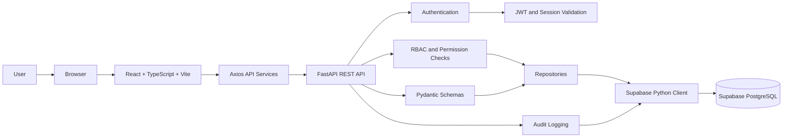
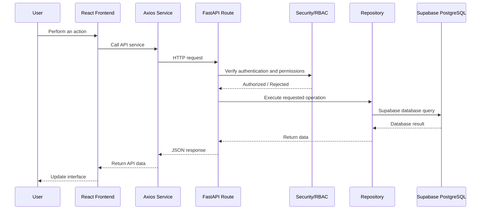
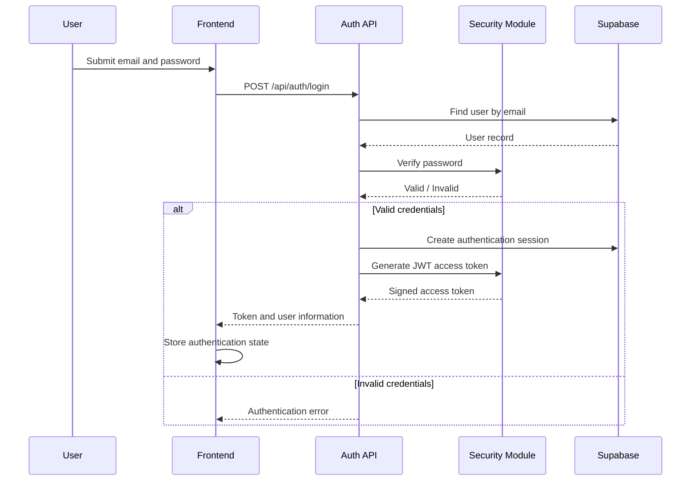
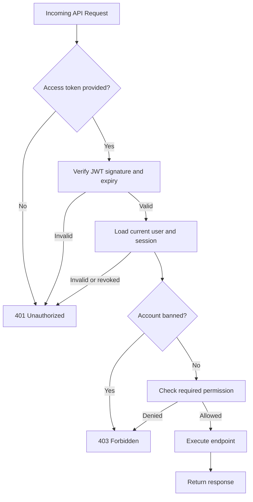
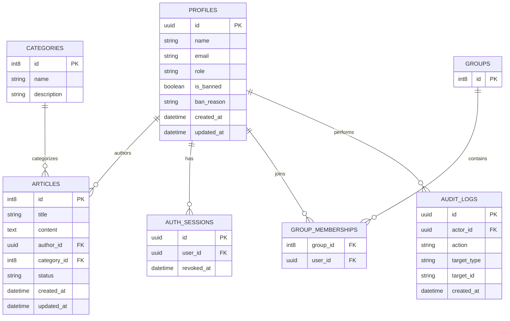
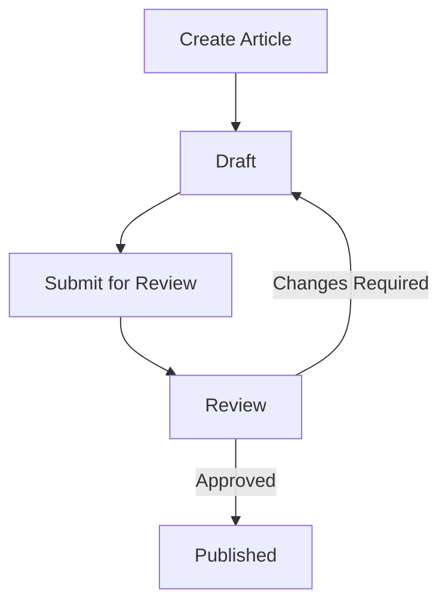
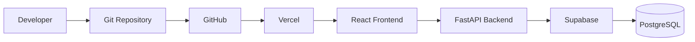
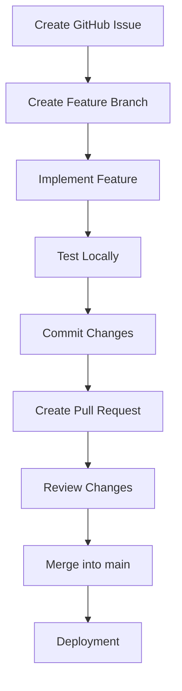

# Technical Design Document (TDD) — DocHub

| Field             | Value                                                                          |
| ----------------- | ------------------------------------------------------------------------------ |
| Product           | DocHub                                                                         |
| Version           | MVP + Beta                                                                     |
| Releases          | MVP — Mid-term, Beta — Final                                                   |
| Status            | Draft                                                                          |
| Frontend          | React + TypeScript + Vite                                                      |
| Backend           | Python + FastAPI                                                               |
| Database          | PostgreSQL on Supabase                                                         |
| Related documents | Product Requirements Document (PRD), Software Requirements Specification (SRS) |

Sections and tables are marked MVP or Beta. Build the MVP features for the mid-term assessment; Beta extends the system with additional security, administration, and collaboration capabilities.

## Documents in this set

| Short form | Full form                           | Purpose                                                         | File     |
| ---------- | ----------------------------------- | --------------------------------------------------------------- | -------- |
| PRD        | Product Requirements Document       | What we build and why                                           | `prd.md` |
| SRS        | Software Requirements Specification | Exact requirements, permissions and acceptance criteria         | `srs.md` |
| TDD        | Technical Design Document           | How we build it: architecture, database, API and implementation | `tdd.md` |

# 1. Overview

DocHub is an internal knowledge-sharing platform where users can create, manage, organize, and access documentation. It provides article management, categories, groups, authentication, and administrative controls.

**MVP — Mid-term:** A React frontend communicates with a FastAPI REST API. The backend uses the Supabase Python client to interact with a PostgreSQL database hosted on Supabase. Users can authenticate and work with articles and categories through the application.

**Beta — Final:** The platform extends the MVP with stronger JWT session management, role-based access control (RBAC), group collaboration, administrative moderation, audit logging, account management, and security monitoring.

The application has two global account roles:

- `user` — A normal authenticated account that accesses platform features according to ownership, group membership, and permissions.
- `admin` — An administrative account with additional user-management, moderation, and system-management permissions.

Group membership and group permissions are separate from these global roles. They do not create additional global account roles.

# 2. Technology stack

| Layer             | Technology                               | Purpose                                                      | Release |
| ----------------- | ---------------------------------------- | ------------------------------------------------------------ | ------- |
| Frontend          | React                                    | Component-based user interface                               | MVP     |
| Language          | TypeScript                               | Type safety and maintainability                              | MVP     |
| Frontend tooling  | Vite                                     | Development server and production build                      | MVP     |
| Styling           | Tailwind CSS                             | Responsive UI styling                                        | MVP     |
| Icons             | Lucide React                             | Interface icons                                              | MVP     |
| HTTP client       | Axios                                    | Frontend-to-backend API communication                        | MVP     |
| Backend           | FastAPI                                  | REST API, validation, dependencies and OpenAPI documentation | MVP     |
| Backend language  | Python                                   | Backend implementation                                       | MVP     |
| Validation        | Pydantic                                 | Request and response validation                              | MVP     |
| Configuration     | pydantic-settings                        | Environment-based configuration                              | MVP     |
| Database          | PostgreSQL on Supabase                   | Persistent application data                                  | MVP     |
| Database client   | Supabase Python client                   | Backend database operations                                  | MVP     |
| Authentication    | PyJWT                                    | JWT creation and verification                                | Beta    |
| Password security | Password hashing with server-side pepper | Secure password storage and verification                     | Beta    |
| Authorization     | Custom RBAC module                       | Role, ownership and permission checks                        | Beta    |
| Audit logging     | Custom audit module                      | Record important system actions                              | Beta    |
| Frontend hosting  | Vercel                                   | Frontend deployment                                          | MVP     |
| Backend hosting   | Configured API deployment environment    | Serve FastAPI endpoints                                      | MVP     |
| Version control   | Git and GitHub                           | Source control, issues, branches and pull requests           | MVP     |

**Important implementation decisions**

- The database is PostgreSQL hosted on Supabase.
- The backend uses the Supabase Python client through `app/db.py`.
- SQLAlchemy and SQLModel are not used as the application's database access layer.
- Database tables are managed in Supabase.
- The frontend communicates with the backend API instead of accessing the database directly.
- The Supabase service-role key must remain on the backend and must never be exposed to the frontend.

# 3. Architecture

## 3.1 System architecture



The application is separated into three main layers:

1. **Frontend:** React components, pages, contexts, services, and TypeScript types.
2. **Backend:** FastAPI routes, schemas, authentication, RBAC, repositories, and audit logging.
3. **Database:** PostgreSQL tables hosted on Supabase.

The frontend does not communicate directly with PostgreSQL. All data operations pass through the FastAPI backend.

## 3.2 Request flow



For protected endpoints, the backend verifies the access token and checks the user's current database state. It then checks the relevant role, ownership, or group permissions before allowing the operation.

## 3.3 Authentication flow



The exact frontend token-storage and refresh-token transport behavior must follow the implementation in `security.py`, `auth_route.py`, and `AuthContext.tsx`.

## 3.4 Authorization flow



Authentication establishes who the user is. Authorization determines whether that user can perform a particular action.

# 4. Project structure

## 4.1 Backend structure

The backend is organized into application modules. Routes handle HTTP requests, schemas validate data, repositories perform database operations, and security modules enforce authentication and authorization.

```text
backend/
├── app/
│   ├── audit.py
│   ├── config.py
│   ├── db.py
│   ├── main.py
│   ├── rbac.py
│   ├── security.py
│   │
│   ├── repositories/
│   │   ├── admin_repository.py
│   │   ├── article_repository.py
│   │   ├── auth_repository.py
│   │   ├── category_repository.py
│   │   ├── group_repository.py
│   │   └── user_repository.py
│   │
│   ├── routes/
│   │   ├── admin_route.py
│   │   ├── article_route.py
│   │   ├── auth_route.py
│   │   ├── category_route.py
│   │   ├── group_route.py
│   │   └── user_route.py
│   │
│   └── schemas/
│       ├── article_schema.py
│       ├── auth_schema.py
│       └── category_schema.py
│
└── requirements.txt
```

### Backend module responsibilities

| File / Directory   | Responsibility                                                                         |
| ------------------ | -------------------------------------------------------------------------------------- |
| `main.py`          | Creates the FastAPI application, configures middleware and includes routers            |
| `config.py`        | Loads application configuration and environment variables                              |
| `db.py`            | Initializes and exports the Supabase client                                            |
| `security.py`      | JWT creation, token verification, password security and session-related security logic |
| `rbac.py`          | Role and permission checking                                                           |
| `audit.py`         | Records important application and administrative actions                               |
| `routes/`          | Defines REST API endpoints and handles HTTP requests                                   |
| `schemas/`         | Defines request and response validation models                                         |
| `repositories/`    | Contains database queries and data-access operations                                   |
| `requirements.txt` | Lists Python dependencies                                                              |

### Backend design rules

1. Routes should handle HTTP-specific responsibilities.
2. Pydantic schemas should validate incoming and outgoing data.
3. Repositories should contain database access operations.
4. Authentication and permission checks should be reusable.
5. Sensitive information must never be returned in API responses.
6. Database operations should be performed through the Supabase client.
7. Important security and administrative actions should be recorded in the audit log.

## 4.2 Frontend structure

The following is the current frontend directory structure.

```text
frontend/src/
├── App.tsx
├── assets/
│   ├── hero.png
│   ├── react.svg
│   └── vite.svg
│
├── components/
│   ├── common/
│   │   ├── Loading.tsx
│   │   └── ProtectedRoute.tsx
│   ├── layout/
│   │   └── AppShell.tsx
│   └── MarkdownEditor.tsx
│
├── contexts/
│   └── AuthContext.tsx
│
├── index.css
├── main.tsx
│
├── pages/
│   ├── Account.tsx
│   ├── AdminDashboard.tsx
│   ├── ArticleDetails.tsx
│   ├── ContributorDashboard.tsx
│   ├── Dashboard.tsx
│   ├── EditArticle.tsx
│   ├── Groups.tsx
│   ├── Home.tsx
│   ├── Login.tsx
│   └── Register.tsx
│
├── services/
│   ├── adminService.ts
│   ├── api.ts
│   ├── articleService.ts
│   ├── authService.ts
│   ├── categoryService.ts
│   ├── groupService.ts
│   └── userService.ts
│
└── types/
    ├── article.ts
    ├── category.ts
    └── user.ts
```

### Frontend module responsibilities

| File / Directory              | Responsibility                                                    |
| ----------------------------- | ----------------------------------------------------------------- |
| `App.tsx`                     | Main application component and frontend routing                   |
| `main.tsx`                    | React application entry point                                     |
| `index.css`                   | Global styles                                                     |
| `assets/`                     | Static images and assets                                          |
| `components/common/`          | Shared components such as loading indicators and protected routes |
| `components/layout/`          | Shared application layout                                         |
| `MarkdownEditor.tsx`          | Article content editing interface                                 |
| `contexts/AuthContext.tsx`    | Authentication state and current-user information                 |
| `pages/`                      | Main application screens                                          |
| `services/api.ts`             | Central Axios configuration and API communication                 |
| `services/authService.ts`     | Login, registration and authentication-related API calls          |
| `services/articleService.ts`  | Article API operations                                            |
| `services/categoryService.ts` | Category API operations                                           |
| `services/groupService.ts`    | Group API operations                                              |
| `services/userService.ts`     | User-related API operations                                       |
| `services/adminService.ts`    | Administrative API operations                                     |
| `types/`                      | TypeScript interfaces and types                                   |

### Frontend architecture rules

- Pages should focus on rendering screens and coordinating user interactions.
- Reusable interface elements belong in `components/`.
- API calls should be centralized in `services/`, rather than duplicated across pages.
- Shared authentication state should be managed through `AuthContext.tsx`.
- Protected pages should use `ProtectedRoute.tsx`.
- TypeScript interfaces should describe the data exchanged with the backend.
- The frontend may hide unavailable actions, but the backend remains responsible for enforcing permissions.

### Main frontend pages

| Page                       | Responsibility                                |
| -------------------------- | --------------------------------------------- |
| `Home.tsx`                 | Public landing page                           |
| `Login.tsx`                | User authentication                           |
| `Register.tsx`             | Account registration                          |
| `Dashboard.tsx`            | Main authenticated user dashboard             |
| `ContributorDashboard.tsx` | Article contribution and management interface |
| `ArticleDetails.tsx`       | Displays an article                           |
| `EditArticle.tsx`          | Creates or edits article content              |
| `Groups.tsx`               | Group and membership interface                |
| `Account.tsx`              | Account information and user settings         |
| `AdminDashboard.tsx`       | Administrative dashboard and management tools |

The contributor dashboard is a frontend screen, not a third global account role. Access to its operations is determined by the backend's permissions and resource rules.

# 5. Database design

## 5.1 Database overview

DocHub uses PostgreSQL through Supabase. The database stores user profiles, articles, categories, groups, authentication sessions, and audit information.

The backend connects to Supabase through the Python client exported from:

```python
# app/db.py

supabase = create_client(
    settings.supabase_url,
    settings.supabase_service_role_key
)
```

The exact configuration variable names must match `config.py`.

## 5.2 Main database tables

### profiles

Stores user account and profile information.

| Column       | Type      | Rules                                   |
| ------------ | --------- | --------------------------------------- |
| `id`         | UUID      | Primary key                             |
| `name`       | Text      | User's display name                     |
| `email`      | Text      | User email                              |
| `role`       | Text      | `user` or `admin`                       |
| `is_banned`  | Boolean   | Indicates whether the account is banned |
| `ban_reason` | Text      | Nullable ban reason                     |
| `created_at` | Timestamp | Account creation time                   |
| `updated_at` | Timestamp | Last update time                        |

Password-related information must be handled securely. Never expose password values or password hashes through profile responses.

### articles

Stores documentation articles.

| Column        | Type             | Rules                             |
| ------------- | ---------------- | --------------------------------- |
| `id`          | BIGINT (`int8`)  | Primary key                       |
| `title`       | Text             | Article title                     |
| `content`     | Text             | Article content                   |
| `category_id` | Foreign key      | References `categories`           |
| `author_id`   | UUID foreign key | References `profiles.id`          |
| `status`      | Text             | `draft`, `review`, or `published` |
| `created_at`  | Timestamp        | Creation time                     |
| `updated_at`  | Timestamp        | Last update time                  |

The article ID is a BIGINT, not a UUID. The author ID references a profile UUID.

### categories

Stores article categories.

| Column        | Type                  | Rules                             |
| ------------- | --------------------- | --------------------------------- |
| `id`          | Database-generated ID | Primary key                       |
| `name`        | Text                  | Category name                     |
| `description` | Text                  | Category description, if provided |

### groups

Stores collaboration groups.

| Column             | Type                       | Rules                            |
| ------------------ | -------------------------- | -------------------------------- |
| `id`               | Database-generated ID      | Primary key                      |
| Additional columns | Defined by database schema | Group information and timestamps |

### group membership

Stores the relationship between users and groups. Group membership and permissions are separate from the global `profiles.role` field.

The database determines which users belong to a group and which group-level permissions they have.

### auth_sessions

Stores authentication session information used for session validation and revocation.

| Column                    | Type             | Rules                                |
| ------------------------- | ---------------- | ------------------------------------ |
| Session identifier        | Database-defined | Identifies an authentication session |
| User identifier           | UUID reference   | References the associated user       |
| Token/session information | Database-defined | Used for session validation          |
| `revoked_at`              | Timestamp        | Nullable; indicates revocation       |

The backend must reject revoked sessions.

### audit_logs

Stores important system and administrative activity.

The audit system records the actor, action, target, and relevant metadata when available. Sensitive values such as passwords, JWTs, and secret keys must not be recorded.

## 5.3 Entity relationship diagram



This diagram represents the main relationships. Exact column types and constraints for groups, memberships, sessions, and audit logs should be kept synchronized with the actual Supabase schema.

## 5.4 Article status workflow

Articles use three statuses:

| Status      | Meaning                             |
| ----------- | ----------------------------------- |
| `draft`     | Article is still being prepared     |
| `review`    | Article is awaiting review          |
| `published` | Article is approved for publication |



The backend validates status changes according to the permissions and rules implemented for the article operation.

# 6. API design

## 6.1 API overview

The backend exposes REST endpoints through FastAPI.

Base API path:

```text
/api
```

API documentation:

```text
/api/docs
/api/openapi.json
```

Health endpoint:

```text
/health
```

All API responses use JSON unless the endpoint explicitly returns another format, such as CSV.

## 6.2 API modules

| Module             | Responsibility                                                   | Release  |
| ------------------ | ---------------------------------------------------------------- | -------- |
| Authentication API | Registration, login, token and session operations                | MVP/Beta |
| User API           | User profile and account operations                              | MVP/Beta |
| Article API        | Article CRUD and article access                                  | MVP      |
| Category API       | Category management                                              | MVP      |
| Group API          | Groups, memberships and group permissions                        | Beta     |
| Admin API          | User management, moderation, statistics and security information | Beta     |

## 6.3 Authentication endpoints

The authentication router handles account authentication and session-related operations.

| Method | Endpoint             | Purpose                       | Expected response                 |
| ------ | -------------------- | ----------------------------- | --------------------------------- |
| POST   | `/api/auth/register` | Register an account           | User information                  |
| POST   | `/api/auth/login`    | Authenticate a user           | Access token and user information |
| POST   | `/api/auth/refresh`  | Refresh an access token       | New access token                  |
| POST   | `/api/auth/logout`   | End an authentication session | Success response                  |

The exact endpoint paths and response fields must match the current `auth_route.py` and frontend `authService.ts` implementation.

## 6.4 Article endpoints

| Method | Endpoint                     | Purpose                     |
| ------ | ---------------------------- | --------------------------- |
| GET    | `/api/articles`              | Retrieve articles           |
| POST   | `/api/articles`              | Create an article           |
| GET    | `/api/articles/{article_id}` | Retrieve a specific article |
| PATCH  | `/api/articles/{article_id}` | Update an article           |
| DELETE | `/api/articles/{article_id}` | Delete an article           |

The backend validates the article ID, request body, author ownership, and applicable permissions.

## 6.5 Category endpoints

| Method | Endpoint                        | Purpose             |
| ------ | ------------------------------- | ------------------- |
| GET    | `/api/categories`               | Retrieve categories |
| POST   | `/api/categories`               | Create a category   |
| PATCH  | `/api/categories/{category_id}` | Update a category   |
| DELETE | `/api/categories/{category_id}` | Delete a category   |

The backend validates category operations and handles article references according to the database constraints and implemented deletion behavior.

## 6.6 User endpoints

| Method | Endpoint        | Purpose                           |
| ------ | --------------- | --------------------------------- |
| GET    | `/api/users/me` | Retrieve current user information |
| PATCH  | `/api/users/me` | Update current user information   |

Additional account operations should follow the actual implementation in `user_route.py`.

## 6.7 Group endpoints

The group router handles group creation, retrieval, membership, and permission-related operations.

| Method | Endpoint                         | Purpose                                       |
| ------ | -------------------------------- | --------------------------------------------- |
| GET    | `/api/groups`                    | Retrieve groups available to the current user |
| POST   | `/api/groups`                    | Create a group                                |
| GET    | `/api/groups/{group_id}`         | Retrieve group information                    |
| PATCH  | `/api/groups/{group_id}`         | Update group information                      |
| DELETE | `/api/groups/{group_id}`         | Delete a group                                |
| GET    | `/api/groups/{group_id}/members` | Retrieve group members                        |

Other membership and permission endpoints depend on the operations implemented in `group_route.py`.

## 6.8 Administrative endpoints

The admin router provides administrative operations.

| Method | Endpoint                                             | Purpose                           |
| ------ | ---------------------------------------------------- | --------------------------------- |
| GET    | `/api/admin/dashboard`                               | Retrieve dashboard statistics     |
| GET    | `/api/admin/users`                                   | Retrieve and filter users         |
| GET    | `/api/admin/users/{user_id}`                         | Retrieve user details             |
| PATCH  | `/api/admin/users/{user_id}/role`                    | Change a user's global role       |
| POST   | `/api/admin/users/{user_id}/ban`                     | Ban a user                        |
| POST   | `/api/admin/users/{user_id}/unban`                   | Unban a user                      |
| POST   | `/api/admin/users/{user_id}/revoke-sessions`         | Revoke user sessions              |
| GET    | `/api/admin/moderation/articles`                     | Retrieve articles for moderation  |
| PATCH  | `/api/admin/moderation/articles/{article_id}/status` | Update article status             |
| DELETE | `/api/admin/moderation/articles/{article_id}`        | Delete an article                 |
| GET    | `/api/admin/moderation/groups`                       | Retrieve groups for moderation    |
| DELETE | `/api/admin/moderation/groups/{group_id}`            | Delete a group                    |
| GET    | `/api/admin/audit-logs`                              | Retrieve audit records            |
| GET    | `/api/admin/security/failed-logins`                  | Retrieve failed-login information |
| GET    | `/api/admin/export/{table}.csv`                      | Export supported data as CSV      |

All administrative endpoints require the appropriate administrative authorization.

## 6.9 API response and error handling

The backend uses HTTP status codes to communicate the result of each operation.

| Status code                 | Meaning                                                |
| --------------------------- | ------------------------------------------------------ |
| `200 OK`                    | Request completed successfully                         |
| `201 Created`               | Resource created successfully                          |
| `204 No Content`            | Request completed without a response body              |
| `400 Bad Request`           | Invalid operation or business rule violation           |
| `401 Unauthorized`          | Missing or invalid authentication                      |
| `403 Forbidden`             | User does not have permission                          |
| `404 Not Found`             | Requested resource does not exist or is not accessible |
| `409 Conflict`              | Conflict with existing data or resource state          |
| `422 Unprocessable Entity`  | Request validation failed                              |
| `500 Internal Server Error` | Unexpected server error                                |

Example error response:

```json
{
  "detail": "Invalid or expired token"
}
```

Pydantic validation errors use FastAPI's standard `422` response format.

# 7. Database access and repositories

The backend uses the Supabase Python client for database operations.

The client is initialized centrally in `app/db.py` and imported by repository modules.

```python
# Example repository pattern

from app.db import supabase

def get_article(article_id: int):
    response = (
        supabase
        .table("articles")
        .select("*")
        .eq("id", article_id)
        .execute()
    )

    return response.data
```

The example illustrates the access pattern. Actual repository functions should retain the project's existing query logic and error handling.

### Repository responsibilities

| Repository               | Responsibility                                         |
| ------------------------ | ------------------------------------------------------ |
| `article_repository.py`  | Article database operations                            |
| `auth_repository.py`     | Authentication and session-related database operations |
| `category_repository.py` | Category database operations                           |
| `group_repository.py`    | Group and membership database operations               |
| `user_repository.py`     | User and profile database operations                   |
| `admin_repository.py`    | Administrative queries and management operations       |

### Database access rules

1. Database operations should be centralized in repositories.
2. Routes should not duplicate database queries unnecessarily.
3. User-controlled values must be validated before database operations.
4. Access to private data must be restricted by backend authorization.
5. Database credentials must remain on the backend.
6. Responses must not expose internal authentication or security data.

# 8. Configuration and environment variables

Sensitive configuration is loaded from environment variables through `config.py`.

| Variable                       | Purpose                                                             | Required in production                         |
| ------------------------------ | ------------------------------------------------------------------- | ---------------------------------------------- |
| `SUPABASE_URL`                 | Supabase project URL                                                | Yes                                            |
| `SUPABASE_SERVICE_ROLE_KEY`    | Backend database access credential                                  | Yes                                            |
| `SUPABASE_ANON_KEY`            | Supabase public/anonymous key, if required by backend configuration | Depends on implementation                      |
| `JWT_SECRET`                   | Signs and verifies JWT access tokens                                | Yes                                            |
| `PASSWORD_PEPPER`              | Additional secret used in password processing                       | Yes, if enabled by the security implementation |
| Refresh/session encryption key | Used if the implementation encrypts refresh/session data            | If applicable                                  |

The exact environment variable names must match `config.py`.

Example local configuration:

```env
SUPABASE_URL=your_supabase_project_url
SUPABASE_SERVICE_ROLE_KEY=your_service_role_key
JWT_SECRET=your_random_secret
PASSWORD_PEPPER=your_password_pepper
```

Never commit `.env` files or production secrets to GitHub.

The frontend must use only public configuration values. The Supabase service-role key and JWT signing secret must never be included in Vite environment variables.

# 9. Deployment architecture

## 9.1 Deployment overview



The frontend is deployed through Vercel. The FastAPI backend must be deployed to a supported API hosting environment and configured so that the frontend can reach it.

The backend deployment target and production API URL must be documented in the deployment configuration.

## 9.2 Deployment process

1. Developer makes changes locally.
2. Changes are committed to a feature branch.
3. A pull request is created on GitHub.
4. The changes are reviewed and merged into `main`.
5. The configured deployment platform builds and deploys the application.
6. Environment variables are configured in the hosting platform.
7. The deployed frontend communicates with the deployed backend.
8. The backend connects to Supabase PostgreSQL.

## 9.3 CORS

The FastAPI backend must allow requests from the frontend's configured origins.

Development origins:

```text
http://localhost:5173
http://127.0.0.1:5173
```

Production origin:

```text
https://dochub-mauve.vercel.app
```

The production origin must be updated if the deployed frontend URL changes.

# 10. Authentication and RBAC design

## 10.1 Global roles

DocHub uses exactly two global account roles.

| Role    | Description                 |
| ------- | --------------------------- |
| `user`  | Standard authenticated user |
| `admin` | Administrative user         |

An unauthenticated visitor is a guest, not a registered account role.

A user's global role is stored in the database and checked by the backend.

## 10.2 JWT structure

A JSON Web Token consists of three parts:

```text
header.payload.signature
```

| Part      | Purpose                                            |
| --------- | -------------------------------------------------- |
| Header    | Identifies the token type and signing algorithm    |
| Payload   | Contains claims such as the subject and expiration |
| Signature | Verifies that the token has not been modified      |

DocHub uses HS256 for JWT signing.

Example conceptual payload:

```json
{
  "sub": "user-uuid",
  "role": "user",
  "iat": 1795700000,
  "exp": 1795700300
}
```

The example is illustrative; actual claims and token lifetime must match `security.py`.

The backend verifies the signature and expiry before accepting an access token. It also checks the current session and user state.

The role stored in the database is authoritative for authorization. A role value inside a JWT must not be treated as the sole source of permission.

## 10.3 Password security

Passwords must never be stored or returned as plaintext.

The backend uses secure password-processing logic with a server-side pepper where configured. Password verification is performed during authentication.

Security requirements:

- Passwords are never included in API responses.
- Passwords and password hashes are never written to audit logs.
- Secret values are stored in environment variables.
- Password verification happens on the backend.
- Invalid credentials must not reveal whether an email address exists.

The exact hashing algorithm and parameters must match the implementation in `security.py`.

## 10.4 Role-based access control

The RBAC module centralizes authorization logic.

It checks whether an authenticated user has permission to perform an operation.

| Operation                                | `user`                              | `admin`                   |
| ---------------------------------------- | ----------------------------------- | ------------------------- |
| Access permitted user features           | Yes                                 | Yes                       |
| Create and manage own permitted articles | Yes                                 | Yes                       |
| Access permitted group features          | Based on membership and permissions | According to admin policy |
| View administrative dashboard            | No                                  | Yes                       |
| Manage user roles                        | No                                  | Yes                       |
| Ban and unban users                      | No                                  | Yes                       |
| Moderate articles                        | No                                  | Yes                       |
| Manage administrative audit information  | No                                  | Yes                       |
| Access security management features      | No                                  | Yes                       |

This is the global role matrix. Article ownership and group-level permissions can impose additional restrictions.

## 10.5 Ownership and group permissions

Global roles do not automatically grant access to every resource.

The backend also checks:

- Whether the current user owns the resource.
- Whether the current user belongs to the relevant group.
- Whether the group membership grants the required permission.
- Whether the requested operation is permitted for the resource.

These checks must be enforced on the backend, even when the frontend hides unavailable buttons.

## 10.6 Account banning and session revocation

When an administrator bans an account:

1. The backend validates the administrative permission.
2. The target account is checked.
3. The account's banned state and reason are updated.
4. The user's active sessions are revoked.
5. An audit record is created.

A banned user must not be able to continue using protected endpoints.

When an administrator changes a user's global role, the backend must use the updated database role for subsequent authorization checks.

# 11. Administrative system

The administrative dashboard provides an overview of platform activity and management features.

## 11.1 Dashboard statistics

The dashboard can display:

| Metric           | Description                         |
| ---------------- | ----------------------------------- |
| `users_total`    | Total registered users              |
| `banned_users`   | Number of banned users              |
| `records_total`  | Total article records               |
| `groups_total`   | Total groups                        |
| `new_users_7d`   | New users in the last seven days    |
| `new_records_7d` | New articles in the last seven days |
| `new_groups_7d`  | New groups in the last seven days   |

The backend calculates these values from database records.

## 11.2 User management

Administrators can:

- View registered users.
- Search and filter users.
- View user details.
- Change the global role between `user` and `admin`.
- Ban users.
- Unban users.
- Revoke user sessions.

Administrative operations must be authorized by the backend.

## 11.3 Content moderation

Administrators can inspect articles, update their publication status, and delete inappropriate content.

The backend validates moderation requests before applying changes.

## 11.4 Group moderation

Administrators can inspect groups and perform the group-management actions supported by the administrative API.

## 11.5 Audit and security information

The administrative system provides access to audit records and failed-login information.

Audit records should capture important events such as:

- Authentication events.
- Article management.
- User role changes.
- Account banning and unbanning.
- Administrative moderation.
- Session revocation.
- Other security-relevant operations.

Sensitive credentials, passwords, tokens, and secret keys must never be stored in audit records.

# 12. Security design

| Area                 | Design                                                          |
| -------------------- | --------------------------------------------------------------- |
| Authentication       | JWT-based access token verification                             |
| Token signing        | HS256                                                           |
| Password security    | Secure password hashing and server-side pepper where configured |
| Authorization        | Centralized RBAC module                                         |
| Ownership            | Backend resource ownership checks                               |
| Group access         | Group membership and permission validation                      |
| Account status       | Banned accounts are denied protected access                     |
| Session security     | Session validation and revocation                               |
| Database credentials | Stored in backend environment variables                         |
| API validation       | Pydantic request and response validation                        |
| CORS                 | Restricted to configured frontend origins                       |
| Error handling       | Avoid returning internal exception details                      |
| Audit logging        | Record security-sensitive and administrative operations         |
| Data exposure        | Explicit response schemas and filtered database fields          |

The frontend is not a security boundary. A user must not gain access to an operation simply by modifying browser state or sending a request manually.

# 13. Non-functional design requirements

| Area            | Requirement                                                                                         |
| --------------- | --------------------------------------------------------------------------------------------------- |
| Performance     | API operations should return results within a reasonable time under expected academic-project usage |
| Reliability     | Unexpected backend failures should not crash the entire application                                 |
| Security        | Protected resources must require valid authentication and authorization                             |
| Maintainability | Frontend and backend responsibilities should remain separated                                       |
| Scalability     | Repository-based database access and modular API routes should support future features              |
| Usability       | The interface should be responsive and provide clear loading and error states                       |
| Data integrity  | Database relationships and backend validation should prevent invalid records                        |
| Compatibility   | The application should work in modern browsers                                                      |
| Configuration   | Development and production secrets must be managed separately                                       |

# 14. Error handling and validation

The backend validates requests using Pydantic schemas and database constraints.

Common validation rules include:

- Required fields must not be empty.
- Email addresses must have a valid format.
- Article titles must contain meaningful text.
- Article status must use an allowed value.
- IDs must match the expected database type.
- Category and author references must point to valid records.
- Users must not update resources they are not authorized to modify.
- Group operations must validate membership and permissions.

The frontend should display useful error messages returned by the backend and should not assume that a request succeeded before receiving a successful response.

# 15. Testing strategy

Testing should cover both application behavior and security controls.

| Test area        | What to verify                                             |
| ---------------- | ---------------------------------------------------------- |
| Authentication   | Valid and invalid login attempts                           |
| JWT              | Valid signatures, invalid signatures and expired tokens    |
| Authorization    | `user` cannot access admin-only operations                 |
| Admin            | `admin` can access permitted management operations         |
| Article CRUD     | Create, retrieve, update and delete articles               |
| Ownership        | Users cannot modify another user's restricted resources    |
| Categories       | Category creation, retrieval, update and deletion          |
| Groups           | Membership and group permission checks                     |
| Account security | Banned users cannot access protected resources             |
| Sessions         | Revoked sessions are rejected                              |
| Validation       | Invalid request bodies return appropriate errors           |
| Frontend         | Protected routes and authentication state behave correctly |
| Integration      | Frontend services communicate correctly with FastAPI       |

# 16. Development workflow

The project uses GitHub for source control and collaboration.

Recommended workflow:



Development rules:

1. Each feature should have a related GitHub issue.
2. Work should be performed on feature branches.
3. Pull requests should describe the implemented changes.
4. Changes should be tested before merging.
5. The `main` branch should contain the integrated application.
6. Environment files and secrets must not be committed.

# 17. Risks and mitigation

| Risk                                     | Mitigation                                                             |
| ---------------------------------------- | ---------------------------------------------------------------------- |
| Database credentials exposed             | Keep service-role credentials in backend environment variables         |
| Unauthorized article access              | Enforce ownership and permission checks in the backend                 |
| JWT misuse                               | Verify token signatures, expiry and session state                      |
| Role changes not reflected               | Load the current role from the database during authorization           |
| Banned users retain access               | Check account status and revoke sessions                               |
| Database query failures                  | Handle Supabase errors and return appropriate API responses            |
| Frontend and backend become inconsistent | Keep TypeScript types and Pydantic schemas aligned                     |
| Deployment configuration errors          | Verify environment variables and API URLs before deployment            |
| Invalid group access                     | Validate membership and group permissions on every protected operation |
| Sensitive audit information              | Exclude passwords, tokens and secret values from logs                  |

# 18. Future improvements

Potential future improvements include:

- More advanced article search and filtering.
- Article version history.
- Richer Markdown editing and preview.
- Notifications for article review and group activity.
- Improved audit-log filtering.
- Automated backend and frontend tests.
- CI/CD checks for pull requests.
- More detailed API documentation.
- Improved database backup and recovery procedures.

These are future enhancements, not assumptions about the current implementation.

---

**End of Technical Design Document — DocHub**
