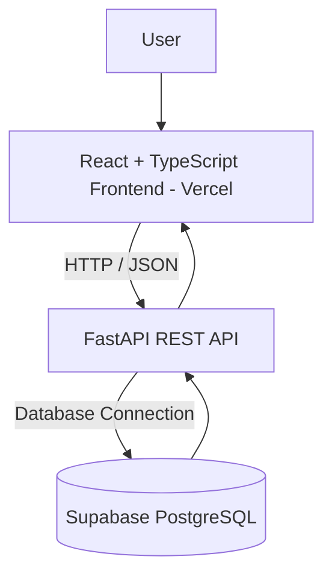

# DocHub – Technical Design Document (TDD)

## 1. Technical Stack

| Layer | Technology | Purpose |
|---|---|---|
| Frontend | React.js | User interface |
| Frontend Language | TypeScript | Type-safe frontend development |
| Build Tool | Vite | Frontend development and production build |
| Backend | Python | Backend application logic |
| Backend Framework | FastAPI | REST API development |
| Data Validation | Pydantic | Request and response validation |
| Database | Supabase PostgreSQL | Persistent relational data storage |
| API Communication | REST over HTTP/JSON | Frontend-backend communication |
| Frontend Hosting | Vercel | Build and host the frontend application |
| Authentication (Beta) | OAuth2 Password Flow and JWT | User authentication |
| Authorization (Beta) | RBAC and Security Scopes | Permission control |
| Version Control | Git and GitHub | Source control and collaboration |

Supabase provides the PostgreSQL database, while Vercel is used to deploy the frontend. FastAPI remains the application backend and exposes the REST API.

## 2. Architecture

DocHub follows a three-tier architecture:

1. **Frontend:** React and TypeScript provide the user interface for viewing, creating, editing, searching, and filtering documentation. The frontend is deployed through Vercel.
2. **Backend:** FastAPI exposes REST endpoints, validates requests, applies application logic, and communicates with Supabase PostgreSQL.
3. **Database:** Supabase PostgreSQL stores users, articles, categories, and tags.

### 2.1 Architecture Diagram



The frontend communicates with FastAPI through REST APIs. The backend handles request validation, application logic, and database operations. In the Beta release, authentication and authorization are also handled by the backend using OAuth2, JWT, RBAC, and security scopes.

## 3. Project Structure

The following is the proposed project organization. File names may be adjusted to match the implementation.

```text
DocHub/
├── frontend/
│   ├── src/
│   │   ├── components/
│   │   ├── pages/
│   │   ├── services/
│   │   ├── types/
│   │   └── App.tsx
│   ├── public/
│   └── package.json
│
├── backend/
│   ├── app/
│   │   ├── routes/
│   │   │   └── article.py
│   │   ├── schemas/
│   │   │   └── article.py
│   │   ├── config.py
│   │   └── main.py
│   ├── .env
│   └── requirements.txt
│
└── README.md
```

### 3.1 Frontend Directories

- `components/`: Reusable interface components.
- `pages/`: Application pages such as article listing, article details, and article editor.
- `services/`: Functions for communicating with the backend API.
- `types/`: TypeScript types and interfaces.

### 3.2 Backend Directories

- `routes/`: FastAPI route definitions and API endpoints.
- `schemas/`: Pydantic request and response schemas.
- `config.py`: Application settings and environment configuration.
- `main.py`: FastAPI application entry point.

## 4. Data Model

DocHub uses Supabase PostgreSQL tables to store application data. The relational model uses primary keys and foreign keys to connect users, articles, categories, and tags.

### 4.1 Profiles Table

The profiles table stores application-level user information.

| Field | Type | Description |
|---|---|---|
| `id` | UUID | Unique user identifier |
| `name` | VARCHAR | User's name |
| `email` | VARCHAR | User's email address |
| `password` | TEXt | User's password |
| `role` | VARCHAR | Reader, Contributor, or Editor (Beta) |


### 4.2 Articles Table

| Field | Type | Description |
|---|---|---|
| `id` | UUID | Unique article identifier |
| `title` | VARCHAR | Article title |
| `content` | TEXT | Markdown article content |
| `category_id` | UUID | Foreign key referencing a category |
| `author_id` | UUID | Foreign key referencing a profile |
| `status` | VARCHAR | Draft, pending review, or published |
| `created_at` | TIMESTAMP | Article creation time |
| `updated_at` | TIMESTAMP | Last update time |

### 4.3 Categories Table

| Field | Type | Description |
|---|---|---|
| `id` | UUID | Unique category identifier |
| `name` | VARCHAR | Category name |
| `description` | TEXT | Category description |

### 4.4 Tags Table

| Field | Type | Description |
|---|---|---|
| `id` | UUID | Unique tag identifier |
| `name` | VARCHAR | Tag name |

### 4.5 Article_Tags Table

This junction table implements the many-to-many relationship between articles and tags.

| Field | Type | Description |
|---|---|---|
| `article_id` | UUID | Foreign key referencing an article |
| `tag_id` | UUID | Foreign key referencing a tag |

The combination of `article_id` and `tag_id` should be unique.

### 4.6 Relationships

- A profile can create multiple articles.
- Each article has one author.
- An article can belong to one category.
- An article can have multiple tags.
- A tag can be assigned to multiple articles.
- `author_id` references `profiles.id`.
- `category_id` references `categories.id`.
- `article_id` and `tag_id` in `article_tags` reference `articles.id` and `tags.id`.

## 5. API Design

The FastAPI backend exposes REST APIs using JSON request and response bodies. The API is organized by resource. Supabase is used as the database, while FastAPI handles application logic and database operations.

### 5.1 Article and Resource Endpoints

| Method | Endpoint | Description | Release |
|---|---|---|---|
| `GET` | `/api/articles` | Get the article list | MVP |
| `POST` | `/api/articles` | Create an article | MVP |
| `GET` | `/api/articles/{article_id}` | Get one article | MVP |
| `PUT` | `/api/articles/{article_id}` | Update an article | MVP |
| `DELETE` | `/api/articles/{article_id}` | Delete an article | MVP |
| `GET` | `/api/categories` | Get categories | MVP |
| `GET` | `/api/tags` | Get tags | MVP |

### 5.2 Authentication and User Endpoints

| Method | Endpoint | Description | Release |
|---|---|---|---|
| `POST` | `/api/auth/register` | Register a user | Beta |
| `POST` | `/api/auth/login` | Authenticate a user and issue a JWT | Beta |
| `GET` | `/api/users/me` | Get the current user's profile | Beta |
| `PATCH` | `/api/users/me` | Update permitted profile information | Beta |

### 5.3 Article Workflow and Role Endpoints

| Method | Endpoint | Description | Release |
|---|---|---|---|
| `POST` | `/api/articles/{article_id}/submit` | Submit an article for review | Beta |
| `POST` | `/api/articles/{article_id}/review` | Review a submitted article | Beta |
| `POST` | `/api/articles/{article_id}/publish` | Publish an approved article | Beta |
| `PATCH` | `/api/users/{user_id}/role` | Update a user's role | Beta |

### 5.4 HTTP Status Codes

| Status Code | Meaning |
|---|---|
| `200 OK` | Request completed successfully |
| `201 Created` | Resource created successfully |
| `400 Bad Request` | Invalid request |
| `401 Unauthorized` | Authentication is required or invalid |
| `403 Forbidden` | User does not have permission |
| `404 Not Found` | Resource does not exist |
| `422 Unprocessable Entity` | Request validation failed |
| `500 Internal Server Error` | Unexpected server error |

The endpoint list describes the planned API design. The final paths should match the implemented FastAPI routes.

## 6. Deployment and Configuration

### 6.1 Supabase Configuration

Supabase provides the PostgreSQL database for DocHub.

Create a Supabase project and use its PostgreSQL connection details to configure the FastAPI backend. Store the database connection string in an environment variable.

Example backend `.env`:

```env
DATABASE_URL=postgresql://<user>:<password>@<host>:<port>/<database>
```

Database credentials should not be committed to GitHub or exposed in frontend environment variables.

### 6.2 Vercel Configuration

Vercel is used to deploy the React frontend.

Connect the frontend GitHub repository to Vercel and configure the project:

- Set the frontend root directory (for example, `frontend/`).
- Set the build command to `npm run build`.
- Set the output directory to `dist`.
- Configure the production FastAPI base URL as a frontend environment variable, such as `VITE_API_BASE_URL`.
- Redeploy after changing environment variables.

### 6.3 FastAPI Backend Deployment

The frontend is hosted on Vercel. The FastAPI backend must also be deployed to a reachable hosting environment and configured with the Supabase database connection string.

The deployed frontend's API base URL must point to the deployed FastAPI backend.

### 6.4 Local Development

**Backend**

From the backend directory:

```bash
fastapi dev app/main.py
```

The FastAPI development server provides interactive API documentation at:

```text
http://127.0.0.1:8000/docs
```

**Frontend**

From the frontend directory:

```bash
npm install
npm run dev
```

The frontend development server uses the address printed by Vite, commonly:

```text
http://localhost:5173
```

### 6.5 Deployment Checklist

- Configure the Supabase PostgreSQL connection string in the backend environment.
- Configure the frontend API base URL.
- Configure backend CORS to allow the deployed Vercel frontend origin.
- Keep database credentials and JWT secrets out of source control.
- Verify that the deployed frontend can communicate with FastAPI.
- Verify that FastAPI can connect to Supabase PostgreSQL.
- Test the article API operations after deployment.